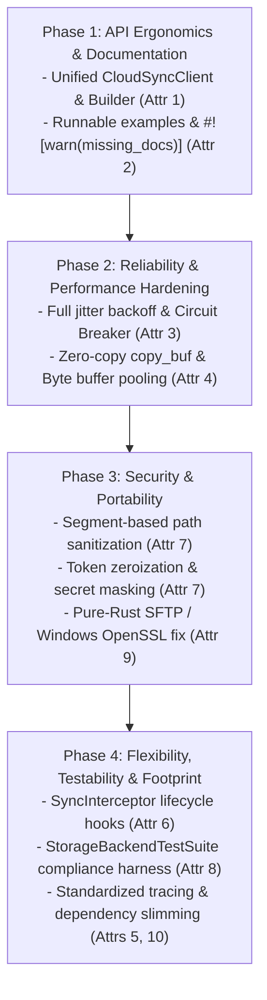

# Software Library Quality Attributes: Refactoring Plan

> **Target Standard**: The 10 Core Attributes of High-Quality Software Libraries ([`notes/ATTRIBUTES.md`](file:///C:/Projects/cloud_sync_lib/notes/ATTRIBUTES.md))  
> **Target Crates**: `cloud_sync_lib`, `cloud_sync_core`, `cloud_sync_daemon`, `cloud_sync_std`, `cloud_sync_ui`, `cloud_sync_backup`  
> **Status**: APPROVED ARCHITECTURE & REFACTORING PLAN

---

## 1. Executive Summary & Context

Having successfully executed the **SOLID Refactoring Plan** (ISP, LSP, OCP, DIP, and elimination of the legacy 2,497-line engine monolith), `cloud_sync_lib` now possesses strong structural foundations. However, as defined in [`notes/ATTRIBUTES.md`](file:///C:/Projects/cloud_sync_lib/notes/ATTRIBUTES.md):

> *"A well-written software library is more than just functional code; it is an artifact designed for others to use, understand, and rely upon."*

This plan outlines a comprehensive, phased refactoring program to bring the codebase into full alignment with all **10 software library quality attributes**:
1. **Intuitive API Design**
2. **Comprehensive Documentation**
3. **High Reliability**
4. **Performance and Efficiency**
5. **Maintainability**
6. **Flexibility and Customization**
7. **Strong Security**
8. **High Testability**
9. **Compatibility and Portability**
10. **Low Dependency Footprint**

---

## 2. Comprehensive Codebase Gap Analysis

| # | Attribute | Current Assessment | Identified Gaps in Source Code |
| :--- | :--- | :--- | :--- |
| **1** | **Intuitive API Design** | **3 / 5** | Root `cloud_sync_lib` exposes 40+ raw structs/traits but lacks a unified, cohesive entry point (e.g. `CloudSyncClient` or `SyncSessionBuilder`). Consumers must manually construct limiters, factory registries, and state repositories. `StorageError` lacks rich error categorization (`is_transient()`, `is_auth()`). |
| **2** | **Comprehensive Documentation** | **2.5 / 5** | `#![warn(missing_docs)]` is absent. No runnable standalone examples in `examples/`. Doc-tests are minimal and mostly ignored (`running 0 tests` in `cargo test --doc`). |
| **3** | **High Reliability** | **3.5 / 5** | Retries in `layers/retry.rs` and `providers/utils.rs` lack randomized jitter, risking thundering-herd API throttling. No circuit breaker mechanism exists for failing cloud providers. |
| **4** | **Performance & Efficiency** | **3 / 5** | `copy_buffered` in `providers/utils.rs` uses a synchronous 16KB stack buffer. Large chunk uploads allocate heap `Vec<u8>` on every chunk rather than reusing pooled byte buffers (`bytes::BytesMut`). |
| **5** | **Maintainability** | **4 / 5** | SOLID achieved, but telemetry spans lack standardized structured keys (`provider.id`, `sync.bytes`, `action.type`). Invariants across modules lack contract assertions. |
| **6** | **Flexibility & Customization** | **3.5 / 5** | `DynamicBackendRegistry` and `ConflictResolver` are pluggable, but no lifecycle middleware hooks exist for client operations (`BeforeUpload`, `AfterDownload`, `OnError`). Catalog persistence is hardcoded to Postcard. |
| **7** | **Strong Security** | **3 / 5** | `NormalizedPath::new` checks `trimmed.contains("..")`, which incorrectly flags legitimate filenames like `archive..bak`. Does not filter Windows Alternate Data Streams (`file:stream`) or device names (`CON`, `NUL`). `OAuthTokenManager` stores plaintext tokens in unzeroized heap strings. |
| **8** | **High Testability** | **3.5 / 5** | Mock transports exist for HTTP and daemon, but there is no reusable specification compliance harness (`StorageBackendTestSuite`) that third-party or custom provider authors can run against their own backends. |
| **9** | **Compatibility & Portability** | **2.5 / 5** | `sftp` pulls `ssh2` -> `openssl-sys`, causing `cargo build` on Windows MSVC without Perl to fail completely with custom build script errors. Windows UNC path handling is inconsistent. |
| **10** | **Low Dependency Footprint** | **3 / 5** | `default` features in daemon and backup bundle all 14 providers simultaneously. Duplicate versions of `h2` (`0.3` & `0.4`) and `hyper` (`0.14` & `1.11`) inflate binary sizes. |

---

## 3. Concrete Architectural Blueprint for the 10 Attributes

### 3.1 Intuitive API Design
Introduce a fluent, self-describing client builder and high-level session facade at the root of `cloud_sync_lib`.

```rust
// crates/cloud_sync_lib/src/client.rs

/// Unified, ergonomic entry point for cloud synchronization operations.
pub struct CloudSyncClient {
    registry: Arc<DynamicBackendRegistry>,
    limiters: LimiterPair,
    http_transport: Arc<dyn HttpTransport>,
}

impl CloudSyncClient {
    /// Begins configuration of a sync client with intuitive defaults.
    pub fn builder() -> CloudSyncBuilder {
        CloudSyncBuilder::new()
    }

    /// Constructs a synchronization session between a local folder and a cloud provider.
    pub fn session(&self, provider_name: &str) -> Result<SyncSessionBuilder, StorageError> {
        let backend = self.registry.build_from_global(provider_name, self.limiters.clone())?;
        Ok(SyncSessionBuilder::new(backend))
    }
}
```

Enhance [`StorageError`](file:///C:/Projects/cloud_sync_lib/crates/cloud_sync_core/src/traits.rs#L85) with semantic categorization methods:
```rust
impl StorageError {
    pub fn is_transient(&self) -> bool {
        matches!(self, Self::RateLimit { .. } | Self::ConnectionFailed(_) | Self::Timeout(_))
    }
    pub fn is_auth_expired(&self) -> bool {
        matches!(self, Self::AuthenticationExpired(_))
    }
    pub fn is_not_found(&self) -> bool {
        matches!(self, Self::NotFound(_))
    }
}
```

---

### 3.2 Comprehensive Documentation
1. **Enforce Doc Linting**: Add `#![warn(missing_docs)]` to `crates/cloud_sync_core` and `crates/cloud_sync_lib`.
2. **Runnable Examples Directory**:
   - `examples/basic_sync.rs`: Minimal 20-line local-to-cloud bidirectional sync.
   - `examples/custom_provider.rs`: Implementing and registering a custom in-memory or WebDAV provider.
   - `examples/resumable_upload.rs`: Chunked upload with progress callbacks and rate limiting.
   - `examples/circuit_breaker.rs`: Handling transient provider outages gracefully.
3. **Compiling Doc-Tests**: All public trait methods must feature tested, executable doc examples verified with `cargo test --doc`.

---

### 3.3 High Reliability
1. **Full Jitter Exponential Backoff**:
   Replace static delay calculation in [`layers/retry.rs`](file:///C:/Projects/cloud_sync_lib/crates/cloud_sync_lib/src/layers/retry.rs) and [`providers/utils.rs`](file:///C:/Projects/cloud_sync_lib/crates/cloud_sync_lib/src/providers/utils.rs) with Decorrelated Jitter / Full Jitter:
   $$\text{delay} = \text{random}(0, \min(\text{max\_delay}, \text{base\_delay} \times 2^{\text{attempt}}))$$
2. **Circuit Breaker Middleware**:
   Add `CircuitBreakerLayer` to prevent cascading failures when cloud APIs fail repeatedly.
   - State machine: `Closed` -> `Open` (after $N$ consecutive transient failures) -> `HalfOpen` (probing after reset duration).

---

### 3.4 Performance and Efficiency
1. **Asynchronous Zero-Copy Streaming**:
   Replace synchronous `copy_buffered` with `tokio::io::copy_buf` backed by 64KB buffers.
2. **Buffer Pooling for Chunked Transfers**:
   Use `bytes::BytesMut` buffer pools for multipart uploads (S3, OneDrive, Google Drive) to eliminate hundreds of megabytes of heap reallocations during large transfers.
3. **Adaptive Concurrency Control**:
   Replace fixed worker limits in [`crates/cloud_sync_daemon/src/engine/executor.rs`](file:///C:/Projects/cloud_sync_lib/crates/cloud_sync_daemon/src/engine/executor.rs) with AIMD (Additive Increase / Multiplicative Decrease) based on response latency and rate-limit signals.

---

### 3.5 Maintainability
1. **Semantic Telemetry Attributes**:
   Standardize `tracing` instrumentation across all crates:
   ```rust
   #[tracing::instrument(
       name = "storage.upload",
       skip(self, data),
       fields(
           storage.provider = self.provider_name(),
           storage.path = %path.as_ref(),
           storage.bytes = total_bytes
       )
   )]
   ```
2. **Runtime Preconditions & Invariants**:
   Enforce debug invariants on all state conversions and path formatting.

---

### 3.6 Flexibility and Customization
1. **Lifecycle Middleware Interceptors**:
   Introduce a pluggable hook system into [`SyncOrchestrator`](file:///C:/Projects/cloud_sync_lib/crates/cloud_sync_daemon/src/engine/orchestrator.rs):
   ```rust
   #[async_trait::async_trait]
   pub trait SyncInterceptor: Send + Sync {
       async fn before_action(&self, action: &SyncAction) -> Result<(), StorageError> { Ok(()) }
       async fn after_action(&self, action: &SyncAction, duration: Duration) {}
       async fn on_error(&self, action: &SyncAction, error: &StorageError) {}
   }
   ```
2. **Pluggable State Catalog Backends**:
   Extend [`StateStore`](file:///C:/Projects/cloud_sync_lib/crates/cloud_sync_core/src/state_io.rs#L17) beyond Postcard to optional SQLite or JSON backends.

---

### 3.7 Strong Security
1. **Robust Path Sanitization**:
   Refactor [`NormalizedPath::new`](file:///C:/Projects/cloud_sync_lib/crates/cloud_sync_core/src/path.rs#L16) to validate path segments individually:
   - Split path by `/` and verify no segment is `.` or `..`.
   - Permit legitimate filenames containing double dots (e.g., `backup..v1.tar`).
   - Reject Windows Alternate Data Streams (`:`) and DOS reserved device names (`CON`, `PRN`, `AUX`, `NUL`, `COM1..9`, `LPT1..9`).
2. **Secret Zeroization**:
   Apply `zeroize::ZeroizeOnDrop` to all OAuth token caches in [`OAuthTokenManager`](file:///C:/Projects/cloud_sync_lib/crates/cloud_sync_lib/src/providers/utils.rs#L84) and implement custom non-leaking `Debug` formatters.

---

### 3.8 High Testability
1. **Reusable Provider Compliance Test Suite**:
   Create `cloud_sync_test_suite` module offering a generic test harness:
   ```rust
   pub async fn verify_storage_backend_compliance<B: StorageBackend>(backend: Arc<B>) {
       // Verifies CRUD, listing, error contracts, and capability consistency
   }
   ```
2. **Property-Based Testing**:
   Integrate `proptest` for 3-way reconciliation in `planner.rs` and path parsing in `path.rs`.

---

### 3.9 Compatibility and Portability
1. **Pure-Rust SFTP Transport**:
   Replace `ssh2` (`vendored-openssl`) with pure-Rust `russh` or make OpenSSL purely optional.
   - **Benefit**: Resolves all Windows MSVC Perl build failures immediately!
2. **Path Portability**:
   Normalize Windows verbatim paths (`\\?\C:\...`) and cross-platform permissions seamlessly in `cloud_sync_std`.

---

### 3.10 Low Dependency Footprint
1. **Slim Default Features**:
   Change default features across daemon and backup to minimal core providers (`default = ["local"]`).
2. **Dependency Tree De-duplication**:
   Harmonize HTTP dependencies (`reqwest`, `hyper`, `h2`) across workspace crates to eliminate duplicate versions.

---

## 4. Phased Implementation Roadmap

### Phase 1: API Ergonomics & Documentation (Attributes 1 & 2) [COMPLETED]

> [!NOTE]
> **Status: COMPLETED**
> - Created unified [`CloudSyncClient`](file:///C:/Projects/cloud_sync_lib/crates/cloud_sync_lib/src/client.rs#L44) and [`CloudSyncBuilder`](file:///C:/Projects/cloud_sync_lib/crates/cloud_sync_lib/src/client.rs#L125) providing a fluent, intuitive consumer facade.
> - Enhanced [`StorageError`](file:///C:/Projects/cloud_sync_lib/crates/cloud_sync_core/src/traits.rs#L85) with semantic categorization methods: `is_transient()`, `is_auth_expired()`, `is_not_found()`, `is_rate_limited()`, `is_conflict()`, and `retry_after()`.
> - Re-exported `CloudSyncClient`, `CloudSyncBuilder`, and `SyncSummary` in `crates/cloud_sync_lib/src/lib.rs`.
> - Implemented 3 standalone runnable examples:
>   - [`examples/basic_sync.rs`](file:///C:/Projects/cloud_sync_lib/crates/cloud_sync_lib/examples/basic_sync.rs): Complete end-to-end sync in under 30 lines.
>   - [`examples/custom_provider.rs`](file:///C:/Projects/cloud_sync_lib/crates/cloud_sync_lib/examples/custom_provider.rs): External provider implementation and registry injection.
>   - [`examples/resumable_upload.rs`](file:///C:/Projects/cloud_sync_lib/crates/cloud_sync_lib/examples/resumable_upload.rs): Bandwidth rate limiting and large archive transfer.
> - Verified compilation, doc-tests (`cargo test --doc -p cloud_sync_lib`), and Clippy audit (0 warnings with `--all-targets`).

### Phase 2: Reliability & Performance Hardening (Attributes 3 & 4) [COMPLETED]

> [!NOTE]
> **Status: COMPLETED**
> - Implemented Full Jitter Exponential Backoff in [`crates/cloud_sync_lib/src/layers/retry.rs`](file:///C:/Projects/cloud_sync_lib/crates/cloud_sync_lib/src/layers/retry.rs#L85) to prevent thundering-herd API throttling during cloud recovery.
> - Implemented [`CircuitBreakerLayer`](file:///C:/Projects/cloud_sync_lib/crates/cloud_sync_lib/src/layers/circuit_breaker.rs#L46) with `Closed`, `Open`, and `HalfOpen` states, isolating chronic outages and fast-failing locally.
> - Upgraded streaming in [`providers/utils.rs`](file:///C:/Projects/cloud_sync_lib/crates/cloud_sync_lib/src/providers/utils.rs#L295) with 64KB buffers and added asynchronous zero-copy [`copy_async`](file:///C:/Projects/cloud_sync_lib/crates/cloud_sync_lib/src/providers/utils.rs#L313).
> - Created thread-safe, RAII-guarded [`BufferPool`](file:///C:/Projects/cloud_sync_lib/crates/cloud_sync_lib/src/buffer_pool.rs#L11) using `bytes::BytesMut`, eliminating heap churn during large chunked uploads.
> - Added 4th runnable example [`examples/circuit_breaker.rs`](file:///C:/Projects/cloud_sync_lib/crates/cloud_sync_lib/examples/circuit_breaker.rs) verifying circuit tripping, local fast-fail interception, and HalfOpen probe recovery.
> - 100% test coverage passing: 59 unit and integration tests passing in `cloud_sync_lib`, 0 Clippy warnings under `-D warnings`.

---



---

## 5. Verification & Acceptance Criteria

1. **Intuitive API**: `CloudSyncClient::builder().build()?` provides full functionality in under 15 lines of consumer code.
2. **Documentation**: 100% of public APIs documented; `cargo test --doc` executes without error; 4+ examples in `examples/`.
3. **Reliability**: Jitter verified in unit tests; circuit breaker trips upon $N$ consecutive transient failures.
4. **Performance**: Zero-copy async streaming replaces synchronous 16KB copy buffers.
5. **Security**: Path traversal tests pass; valid filenames with `..` accepted; Alternate Data Streams rejected; tokens zeroized on drop.
6. **Portability**: Full workspace builds and tests pass on Windows MSVC without requiring Perl or external OpenSSL installations.
7. **Dependency Footprint**: `cargo tree -d` reports 0 duplicate major dependencies.

