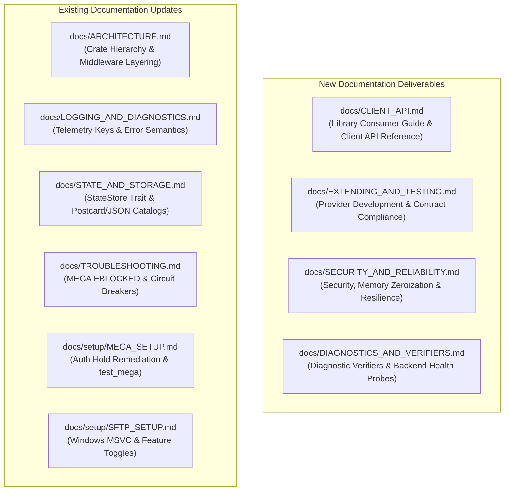
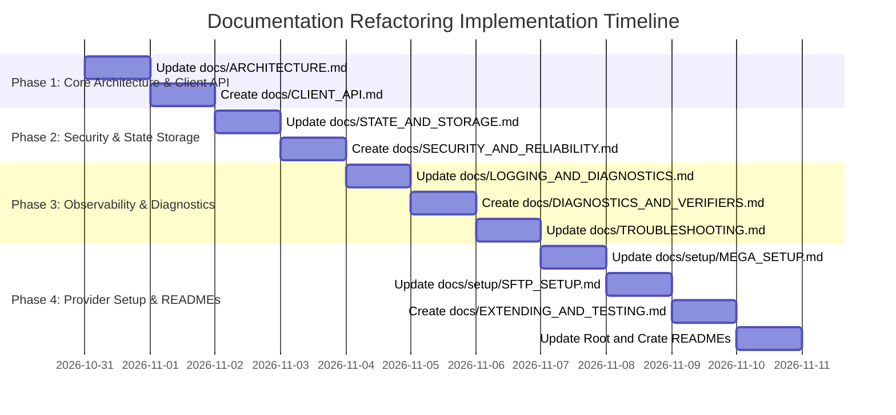

# Documentation Refactoring and Expansion Plan

> **Scope**: Comprehensive audit of existing documentation against the codebase, detailing concrete modifications to existing documents and precise blueprints for new documents across `docs/`, crate READMEs, and the repository root.  
> **Status**: **READY FOR EXECUTION**  
> **Target File**: `DOCUMENTATION_PLAN.md`

---

## 1. Executive Summary & Codebase Divergence Audit

Following the implementation of the **SOLID Refactoring Plan** and the **10 Library Quality Attributes Plan** (API ergonomics, full jitter exponential backoff, circuit breaker layers, 64KB zero-copy I/O, reusable `BytesMut` buffer pools, segment-based `NormalizedPath` validation, `zeroize` credential memory protection, specification compliance test harness, `SyncInterceptor` hooks, pluggable `JsonStateStore`/`PostcardStateStore`, and semantic `StorageError` error handling), the implementation has substantially advanced beyond the existing documentation.

### 1.1 Identified Documentation Gaps

| Documentation Area | Current Status in `docs/` | Codebase Reality & Divergence | Action Required |
| :--- | :--- | :--- | :--- |
| **Workspace Architecture** | `docs/ARCHITECTURE.md` describes monolithic `cloud_sync_lib` with bincode and basic wrappers. | Split into 8 distinct workspace crates (`cloud_sync_core`, `cloud_sync_std`, `cloud_sync_lib`, `cloud_sync_daemon`, `cloud_sync_backup`, `cloud_sync_ui`, `cloud_sync_egui`, `cloud_sync_tauri`). Added layered middleware stack. | **Modify `docs/ARCHITECTURE.md`** |
| **Library Consumer API** | No dedicated consumer API guide. Only daemon setup is documented. | Added `CloudSyncClient` and `CloudSyncBuilder` with fluent configuration, plus 4 runnable examples in `examples/`. | **Create `docs/CLIENT_API.md`** |
| **Provider Authoring & Testing** | Crate README shows single `StorageBackend` trait; no guide for custom backends. | Granular trait decomposition (`StorageReader`, `StorageWriter`, `DirectoryLister`, `ServerSideOperations`, `ResumableUploader`), standardized compliance harness `verify_backend_compliance`, and `SyncInterceptor` hooks. | **Create `docs/EXTENDING_AND_TESTING.md`** |
| **State Storage & Catalogs** | `docs/STATE_AND_STORAGE.md` only covers legacy binary `.bin`/`.bak` files. | Introduced pluggable `StateStore` trait, `PostcardStateStore` with CSTX v1 magic header and checksums, and `JsonStateStore` for human-readable auditability. | **Modify `docs/STATE_AND_STORAGE.md`** |
| **Security Architecture** | Scattered references in README; no unified security architecture document. | Segment-based path validation against traversal/DOS devices in `NormalizedPath`, memory zeroization on drop with `zeroize::Zeroizing<String>` in `OAuthTokenManager`, and AES-256-GCM zero-knowledge encryption. | **Create `docs/SECURITY_AND_RELIABILITY.md`** |
| **Logging & Diagnostics** | `docs/LOGGING_AND_DIAGNOSTICS.md` only covers file sink and `get_log`. | Added standardized structured tracing keys (`storage.provider`, `storage.path`, `storage.bytes`, `sync.action`), semantic `StorageError` predicates (`is_transient`, `is_auth`), and 14 standalone diagnostic verifiers. | **Modify `docs/LOGGING_AND_DIAGNOSTICS.md`** & **Create `docs/DIAGNOSTICS_AND_VERIFIERS.md`** |
| **Troubleshooting & Setup** | `docs/TROUBLESHOOTING.md` and `docs/setup/MEGA_SETUP.md` omit recent operational lessons. | Missing MEGA `EBLOCKED (-16)` account hold / email verification remediation, `CircuitBreakerOpen` recovery, and Windows MSVC OpenSSL/Perl decoupling (`sftp` feature). | **Modify `docs/TROUBLESHOOTING.md`**, `MEGA_SETUP.md`, `SFTP_SETUP.md` |
| **Crate Documentation** | Crate READMEs reflect outdated 0.1.0 monolithic layouts and missing features. | All crates now compile cleanly at workspace 0.2.0 with strict clippy conformance, MSRV 1.75, and feature flags. | **Update root & crate READMEs** |

---

## 2. Plan for New Documents to Create



### 2.1 `docs/CLIENT_API.md`: Library Consumer Guide & Client API Reference
* **Target Audience**: Developers consuming `cloud_sync_lib` as an embedded Rust library in CLI utilities, backend servers, or mobile/desktop apps.
* **Key Sections**:
  1. **Quickstart**: Adding `cloud_sync_lib` to `Cargo.toml` with modular features (e.g., `s3`, `google_drive`, `dropbox`, `mega`).
  2. **The `CloudSyncClient` Facade**: Constructing a client via `CloudSyncBuilder`.
  3. **Layered Middleware Configuration**:
     - Retries: Exponential backoff with full jitter via `RetryLayer` and `RetryConfig`.
     - Fault Isolation: `CircuitBreakerLayer` and `CircuitBreakerConfig` (consecutive failures threshold, recovery timeout, fast-failure semantics).
     - Bandwidth Throttling: `RateLimitLayer` with token buckets.
     - Telemetry & Logging: `LoggingLayer` and `MetricsLayer`.
     - Zero-Knowledge Encryption: Transparent client-side AES-256-GCM encryption with `EncryptedBackend`.
  4. **High-Performance Memory & Streaming**:
     - Zero-copy 64KB asynchronous transfers using `copy_async`.
     - Heap allocation reuse with `BufferPool` and `bytes::BytesMut`.
  5. **Code Examples Walkthrough**:
     - `crates/cloud_sync_lib/examples/basic_sync.rs`
     - `crates/cloud_sync_lib/examples/circuit_breaker.rs`
     - `crates/cloud_sync_lib/examples/custom_provider.rs`
     - `crates/cloud_sync_lib/examples/resumable_upload.rs`

### 2.2 `docs/EXTENDING_AND_TESTING.md`: Provider Development & Specification Compliance
* **Target Audience**: Engineers adding new cloud storage backends (e.g. Seafile, Wasabi) or building custom internal storage adapters.
* **Key Sections**:
  1. **Granular Trait Decomposition**:
     - `StorageBackend`: Core CRUD operations (`upload`, `download`, `delete`, `list`, `create_folder`).
     - `StorageReader` & `StorageWriter`: Segregated read/write capabilities (Interface Segregation Principle).
     - `DirectoryLister`: Traversal and pagination metadata.
     - `ServerSideOperations`: Remote server-side copy (`copy`) and rename (`rename`).
     - `ResumableUploader`: Chunked multi-part upload sessions (`start_resumable_upload`).
  2. **Specification Compliance Test Harness**:
     - Single-call contract verification using `cloud_sync_core::verify_backend_compliance(&backend, temp_dir)`.
     - Contract invariants checked: provider name non-emptiness, byte-for-byte readback integrity, listed size accuracy, strict `NotFound` error return on missing paths, deletion absence, and capability consistency.
  3. **Dynamic Provider Registration**:
     - Registering credentials and builders with `DynamicBackendRegistry` and `BackendRegistry`.
     - Macro-assisted builder generation with `impl_provider_builder!`.
  4. **Lifecycle Interceptors (`SyncInterceptor`)**:
     - Hooking into orchestrator cycles: `before_action`, `after_action`, `on_error`.

### 2.3 `docs/SECURITY_AND_RELIABILITY.md`: Security Model, Memory Protection & Resilience
* **Target Audience**: Security auditors, devops engineers, and systems architects.
* **Key Sections**:
  1. **Path Sanitization & Traversal Defense**:
     - `NormalizedPath`: Segment-by-segment validation enforcing RFC 3986 relative path invariants.
     - Denial of Service & Device Name Filtering: Blocking Windows reserved device names (`CON`, `PRN`, `AUX`, `NUL`, `COM1-9`, `LPT1-9`) and null byte injection (`\0`).
     - Legitimate double-dot filename preservation (e.g. `archive..v1.tar`).
  2. **In-Memory Secret Protection**:
     - Zeroization on drop: `zeroize::Zeroizing<String>` in `OAuthTokenManager`.
     - Custom `Debug` implementations redacting sensitive credentials and tokens (`[REDACTED]`).
  3. **Zero-Knowledge Encryption Decorator**:
     - AES-256-GCM cipher with PBKDF2-HMAC-SHA256 (100,000 rounds) key derivation.
     - Tamper-detection and authenticated chunk tagging.
     - Strict POSIX file permissions (`0600`) for decrypted artifacts.
  4. **Resilience Architecture**:
     - Mathematical model of full jitter exponential backoff ($t = \text{rand}(0, \min(T_{\max}, T_{\text{base}} \times 2^{\text{attempt}}))$).
     - Circuit breaker state machine (Closed $\rightarrow$ Open $\rightarrow$ Half-Open $\rightarrow$ Closed).
     - Non-blocking logging appender preventing I/O queue stalls.

### 2.4 `docs/DIAGNOSTICS_AND_VERIFIERS.md`: Standalone Connection Verifier Suite
* **Target Audience**: System administrators, support engineers, and CI/CD operators.
* **Key Sections**:
  1. **The 14 Diagnostic Binaries**:
     - `check_backends`: Universal health probe testing all enabled cloud providers in `private_config.toml` sequentially.
     - Standalone verifiers: `test_google_drive`, `test_dropbox`, `test_onedrive`, `test_box`, `test_s3`, `test_webdav`, `test_nextcloud`, `test_mega`, `test_azure_blob`, `test_gcs`, `test_b2`, `test_pcloud`, `test_ipfs`.
  2. **The Diagnostic Workflow**:
     - `run_connection_diagnostics`: Remote directory listing $\rightarrow$ temporary test file creation $\rightarrow$ remote upload $\rightarrow$ remote verification $\rightarrow$ remote deletion $\rightarrow$ local cleanup.
  3. **Decoupled Macro Architecture**:
     - How `define_verifier_binary!` binds configuration, provider structs, and diagnostic runners.
  4. **Exit Codes & Automated CI/CD Health Probing**.

---

## 3. Plan for Modifying Existing Documents

### 3.1 `docs/ARCHITECTURE.md`
* **Changes**:
  1. Update high-level Mermaid diagram to display the 8-crate workspace breakdown (`cloud_sync_core`, `cloud_sync_std`, `cloud_sync_lib`, `cloud_sync_daemon`, `cloud_sync_backup`, `cloud_sync_ui`, `cloud_sync_egui`, `cloud_sync_tauri`).
  2. Add Mermaid diagram for the layered middleware pipeline (`StorageLayer` composition).
  3. Document `CloudSyncClient` and `CloudSyncBuilder` entry points.
  4. Document `SyncInterceptor` lifecycle hooks inside `SyncOrchestrator`.
  5. Add cross-references to `CLIENT_API.md`, `SECURITY_AND_RELIABILITY.md`, and `EXTENDING_AND_TESTING.md`.

### 3.2 `docs/LOGGING_AND_DIAGNOSTICS.md`
* **Changes**:
  1. Add Section 3.3 documenting **Standardized Tracing Keys**:
     - `storage.provider`: Provider identifier (e.g. `"Google Drive"`, `"MEGA"`).
     - `storage.path`: Remote path operated on.
     - `storage.bytes`: Number of bytes transferred.
     - `sync.action`: Synchronizer plan action (`"upload"`, `"download"`, `"delete"`).
  2. Add Section 6.2 documenting **Semantic `StorageError` Query Methods**:
     - `is_transient()`, `is_auth()`, `is_not_found()`, `is_rate_limited()`, `is_conflict()`, `retry_after()`.
  3. Document the diagnostic binary suite and link to `DIAGNOSTICS_AND_VERIFIERS.md`.

### 3.3 `docs/STATE_AND_STORAGE.md`
* **Changes**:
  1. Replace legacy mentions of hardcoded `bincode` with the pluggable `StateStore` trait.
  2. Document `PostcardStateStore` (compact binary format with `CSTX` magic header, v1 versioning, FNV-1a checksum validation, atomic write-rename, and `.bak` crash recovery).
  3. Document `JsonStateStore` for human-readable auditability, debugging, and migration tooling.
  4. Document `NormalizedPath` security invariants (segment-based path validation, directory traversal prevention, DOS device rejection).

### 3.4 `docs/TROUBLESHOOTING.md`
* **Changes**:
  1. Add dedicated section **2.4: MEGA Authentication Hold & Blocked Account Remediation**:
     - Explain error code `API_EBLOCKED (-16)` and `"ach": 1` flag returned by `https://g.api.mega.co.nz/cs`.
     - Document that MEGA requires browser login at [mega.nz](https://mega.nz) to clear administrative holds, accept terms, or verify email.
     - Explain how `SimulatedFallback` detects `e.is_auth()` and safely routes traffic to `./cloud_simulation/mega` so the daemon continues syncing other providers.
  2. Add troubleshooting section for **Circuit Breaker Open State**:
     - Diagnosing `StorageError::ConnectionFailed("Circuit breaker open ...")` and adjusting `failure_threshold` / `recovery_timeout`.
  3. Add troubleshooting section for **Windows MSVC SFTP / OpenSSL Build**:
     - Explain that `sftp` is disabled by default to avoid OpenSSL/Perl build requirements on Windows MSVC, and how to enable it with `--features sftp`.

### 3.5 `docs/setup/MEGA_SETUP.md`
* **Changes**:
  1. Add "Account Status & Verification Requirements" section explaining the `EBLOCKED (-16)` hold and `"ach": 1` auth challenge.
  2. Document the diagnostic test command:
     ```bash
     cargo run -p cloud_sync_daemon --bin test_mega
     ```
  3. Clarify automatic `SimulatedFallback` routing when live credentials encounter an auth hold.

### 3.6 `docs/setup/SFTP_SETUP.md`
* **Changes**:
  1. Document that SFTP is an opt-in feature on `cloud_sync_daemon` and `cloud_sync_backup` (`--features sftp`).
  2. Detail build prerequisites for Windows (ActivePerl or Strawberry Perl + MSVC C++ toolchain) vs Linux/macOS.

### 3.7 Root and Crate READMEs
* **`README.md`**: Update workspace overview to highlight client library usage, 4 runnable examples, and links to all updated/new guides.
* **`crates/cloud_sync_lib/README.md`**: Add `CloudSyncClient` quickstart example, middleware layers reference, and buffer pool documentation.
* **`crates/cloud_sync_core/README.md`**: Add specification compliance harness (`verify_backend_compliance`) and `NormalizedPath` security documentation.
* **`crates/cloud_sync_daemon/README.md`**: Document `check_backends` and individual diagnostic verifiers.

---

## 4. Execution Phases & Concrete Work Breakdown



### Phase 1: Core Architecture & Library Consumer API
- [ ] **Step 1.1**: Update [`docs/ARCHITECTURE.md`](docs/ARCHITECTURE.md) with 8-crate workspace hierarchy, layered middleware pipeline diagrams, and `CloudSyncClient` integration.
- [ ] **Step 1.2**: Create [`docs/CLIENT_API.md`](docs/CLIENT_API.md) with complete builder API reference, middleware configuration, and walkthrough of all 4 runnable examples.

### Phase 2: Security, Memory Zeroization & State Persistence
- [ ] **Step 2.1**: Update [`docs/STATE_AND_STORAGE.md`](docs/STATE_AND_STORAGE.md) with `StateStore` trait, `PostcardStateStore` binary format, and `JsonStateStore` auditability.
- [ ] **Step 2.2**: Create [`docs/SECURITY_AND_RELIABILITY.md`](docs/SECURITY_AND_RELIABILITY.md) detailing `NormalizedPath` segment traversal prevention, `zeroize` memory security, AES-256-GCM encryption, and circuit breaker mechanics.

### Phase 3: Observability, Diagnostics & Troubleshooting
- [ ] **Step 3.1**: Update [`docs/LOGGING_AND_DIAGNOSTICS.md`](docs/LOGGING_AND_DIAGNOSTICS.md) with standardized structured tracing keys and `StorageError` semantic predicates.
- [ ] **Step 3.2**: Create [`docs/DIAGNOSTICS_AND_VERIFIERS.md`](docs/DIAGNOSTICS_AND_VERIFIERS.md) documenting `check_backends` and the 13 individual provider verifiers.
- [ ] **Step 3.3**: Update [`docs/TROUBLESHOOTING.md`](docs/TROUBLESHOOTING.md) with MEGA `API_EBLOCKED (-16)` / `"ach": 1` email hold resolution, circuit breaker trips, and Windows MSVC SFTP compilation.

### Phase 4: Provider Development & Documentation Polish
- [ ] **Step 4.1**: Update [`docs/setup/MEGA_SETUP.md`](docs/setup/MEGA_SETUP.md) and [`docs/setup/SFTP_SETUP.md`](docs/setup/SFTP_SETUP.md).
- [ ] **Step 4.2**: Create [`docs/EXTENDING_AND_TESTING.md`](docs/EXTENDING_AND_TESTING.md) detailing custom provider authoring, trait decomposition, `verify_backend_compliance` harness, and `SyncInterceptor` lifecycle hooks.
- [ ] **Step 4.3**: Update root `README.md` and crate READMEs (`cloud_sync_lib/README.md`, `cloud_sync_core/README.md`, `cloud_sync_daemon/README.md`).

---

## 5. Verification & Review Criteria

1. **Link Integrity**: All internal Markdown links use relative paths with file basenames and line ranges where applicable.
2. **Diagram Accuracy**: All Mermaid diagrams conform to supported syntax (`graph TD`, `sequenceDiagram`) and render cleanly.
3. **Code Sample Correctness**: Every code snippet in the documentation must reflect exact, compilable Rust code conforming to the workspace crates.
4. **Zero Outdated Assumptions**: Ensure legacy references to `bincode`, monolithic structures, or unmapped provider errors are completely eradicated.

