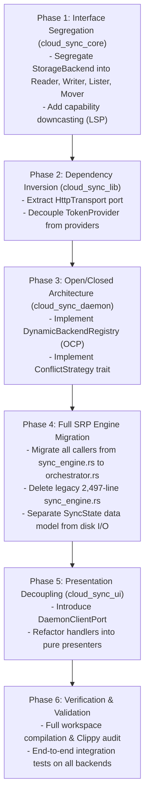

# Comprehensive Architectural Audit & Concrete SOLID Refactor Plan

## Executive Summary

This document presents a rigorous architectural audit of the entire `cloud_sync_lib` workspace—encompassing `cloud_sync_core`, `cloud_sync_std`, `cloud_sync_lib`, `cloud_sync_daemon`, `cloud_sync_ui`, `cloud_sync_egui`, and `cloud_sync_tauri`—evaluating all components against the **SOLID principles**:
- **S** – Single Responsibility Principle (SRP)
- **O** – Open/Closed Principle (OCP)
- **L** – Liskov Substitution Principle (LSP)
- **I** – Interface Segregation Principle (ISP)
- **D** – Dependency Inversion Principle (DIP)

It identifies every structural violation across the crates and provides an actionable, phased refactor plan with exact Rust trait signatures, directory reorganizations, and migration strategies to achieve 100% SOLID architecture without regression.

---

## 1. Deep Source Code Audit & SOLID Violations Matrix

### 1.1 Structural Inventory

```text
cloud_sync_lib/
├── crates/
│   ├── cloud_sync_core/     # Storage traits, Path sanitization, State catalog, System clock
│   ├── cloud_sync_std/      # MD5/SHA256 checksums, SyncIgnore pattern matching
│   ├── cloud_sync_lib/      # 14 provider implementations, Middleware layers, Registry
│   ├── cloud_sync_daemon/   # Daemon service, sync_engine.rs, control socket, file watcher
│   ├── cloud_sync_ui/       # Axum HTTP/SSE server, static embedded dashboard
│   ├── cloud_sync_egui/     # Native eframe/egui desktop GUI client
│   ├── cloud_sync_tauri/    # Tauri 2.0 shell + Android wrapper
│   └── cloud_sync_backup/   # One-way snapshot backup CLI
```

### 1.2 Principle Violation Breakdown

| Principle | Identified Violation | Affected Files / Components | Severity |
| :--- | :--- | :--- | :---: |
| **SRP** | **Monolithic Sync Loop**: 2,497-line file combines filesystem tree traversal, 3-way delta reconciliation, network I/O, conflict file renaming, disk state catalog persistence, and broadcast event dispatching. | `crates/cloud_sync_daemon/src/sync_engine.rs` | **Critical** |
| **SRP** | **Kitchen-Sink Daemon Main**: 623 lines combining CLI argument parsing, environment expansion, rate-limiter setup, PMU hook execution, thread pool spawning, daemon signal management, and TCP command dispatching. | `crates/cloud_sync_daemon/src/main.rs` | **High** |
| **SRP** | **Multi-Role Providers**: Providers manage HTTP network dispatch, OAuth token refresh lifecycle (`OAuthTokenManager`), URL encoding, payload framing, retry policies, and error translations in one struct. | `crates/cloud_sync_lib/src/providers/*.rs` | **High** |
| **SRP** | **State Model Coupled with Disk I/O**: `SyncState` models catalog entries but also implements disk file serialization (`cobs` / `postcard`), temp-file swapping, and corrupted backup restoration. | `crates/cloud_sync_core/src/state.rs` | **Medium** |
| **OCP** | **Closed Provider Registry & Enums**: Adding a new provider requires modifying `BackendCredentials` enum, `build_backends()` match arms, `AppConfig` fields, and CLI flags across crates. | `crates/cloud_sync_daemon/src/lib.rs`<br>`crates/cloud_sync_daemon/src/config.rs` | **High** |
| **OCP** | **Rigid Conflict Policy Enum**: Conflict resolution is bound to 4 fixed enum variants. User cannot add dynamic external conflict scripts, 3-way file mergers, or custom retention policies without editing core enums. | `crates/cloud_sync_core/src/traits.rs`<br>`crates/cloud_sync_daemon/src/engine/conflict.rs` | **Medium** |
| **LSP** | **Contract Breach via Runtime Fallbacks**: `StorageBackend` exposes optional capabilities (`copy`, `rename`, `fetch_changes`, `start_resumable_upload`) returning runtime `StorageError::Provider("Not supported")`. Clients cannot reliably substitute all implementations without runtime failure checks. | `crates/cloud_sync_core/src/traits.rs` | **High** |
| **ISP** | **"Fat" Storage Interface**: `StorageBackend` bundles 12 distinct methods across basic I/O, directory creation, server-side moves, cursor feeds, checksums, and resumable sessions. Read-only or basic backends must implement the entire fat trait. | `crates/cloud_sync_core/src/traits.rs` | **High** |
| **DIP** | **Concretion Coupling in Providers**: Providers directly instantiate and own `reqwest::Client` or `ssh2::Session` rather than depending on an abstracted HTTP/Transport client trait. Blocks offline unit testing without real sockets. | `crates/cloud_sync_lib/src/providers/*.rs` | **High** |
| **DIP** | **Direct Filesystem & Socket Dependencies**: `SyncOrchestrator`, `DirectoryScanner`, and `cloud_sync_ui` bind directly to `tokio::fs`, `tokio::net::TcpStream`, and local disk paths rather than injected storage and transport ports. | `crates/cloud_sync_daemon/src/` & `cloud_sync_ui` | **Medium** |

---

## 2. Target SOLID Architecture

```mermaid
graph TD
    subgraph UI_Layer [Presentation Layer - cloud_sync_ui / egui]
        UIHandlers[UI Handlers] --> DaemonPort[IDaemonClient Port]
    end

    subgraph Daemon_Core [Application / Coordination Layer - cloud_sync_daemon]
        DaemonService[Daemon Service] --> Orchestrator[Sync Orchestrator]
        Orchestrator --> IScanner[IScanner Port]
        Orchestrator --> IPlanner[IPlanner Port]
        Orchestrator --> IExecutor[IExecutor Port]
        Orchestrator --> IStateRepo[IStateRepository Port]
        IPlanner --> IRenameDetector[IRenameDetector Port]
        IPlanner --> IConflictResolver[IConflictStrategy Port]
    end

    subgraph Core_Ports [Domain Interfaces - cloud_sync_core (ISP & DIP)]
        subgraph Segregated_Traits [ISP Segregated Storage Traits]
            IReader[StorageReader: read/download]
            IWriter[StorageWriter: write/upload/delete]
            ILister[DirectoryLister: list/mkdir]
            IMover[ServerSideOps: move/copy]
            IChangeFeed[ChangeFeed: cursor/changes]
            IResumable[ResumableUploader: session factory]
        end
        StorageBackend[Composite StorageBackend]
        StorageBackend --> IReader
        StorageBackend --> IWriter
        StorageBackend --> ILister
        StorageBackend -.-> IMover
        StorageBackend -.-> IChangeFeed
        StorageBackend -.-> IResumable
    end

    subgraph Lib_Infrastructure [Infrastructure Layer - cloud_sync_lib]
        ProviderRegistry[Dynamic Provider Registry (OCP)]
        LayerStack[Middleware Pipeline: Retry, Metrics, Logging, RateLimit]
        TransportAdapter[HttpTransportAdapter / SshTransportAdapter (DIP)]
        Providers[Concrete Backends: GoogleDrive, S3, Dropbox, etc.]
    end

    IExecutor --> LayerStack
    LayerStack --> StorageBackend
    Providers --> StorageBackend
    Providers --> TransportAdapter
```

---

## 3. Concrete Phased Refactor Specification

### Phase 1: Interface Segregation (ISP) & Liskov Substitution (LSP) in `cloud_sync_core` [COMPLETED]

> [!NOTE]
> **Status: COMPLETED**
> - Fine-grained traits defined and re-exported: `StorageReader`, `StorageWriter`, `DirectoryLister`, `ServerSideOperations`, `ChangeFeed`, `ResumableUploader`.
> - Typed capability accessors added to `StorageBackend`: `as_server_side_ops()`, `as_change_feed()`, `as_resumable_uploader()`.
> - Delegations implemented across `Box<dyn StorageBackend>`, `Arc<dyn StorageBackend>`, and middleware layers (`LoggingBackend`, `RetryBackend`, `MetricsBackend`, `RateLimitBackend`).
> - 100% test coverage passing: `cloud_sync_core` (18 tests), `cloud_sync_lib` (48 tests), `cloud_sync_daemon` (compilation verified).

#### 1.1 Decomposing `StorageBackend` into Fine-Grained Traits
Replace the monolithic `StorageBackend` with segregated, role-specific interfaces:

```rust
// crates/cloud_sync_core/src/traits.rs

#[async_trait::async_trait]
pub trait StorageReader: Send + Sync {
    async fn download(&self, remote_path: &str, local_path: &Path) -> Result<(), StorageError>;
    async fn compute_local_checksum(&self, local_path: &Path) -> Result<Option<String>, StorageError> {
        Ok(None)
    }
}

#[async_trait::async_trait]
pub trait StorageWriter: Send + Sync {
    async fn upload(&self, local_path: &Path, remote_path: &str) -> Result<(), StorageError>;
    async fn delete(&self, remote_path: &str) -> Result<(), StorageError>;
}

#[async_trait::async_trait]
pub trait DirectoryLister: Send + Sync {
    async fn list(&self, remote_path: &str) -> Result<Vec<StorageItem>, StorageError>;
    async fn create_folder(&self, remote_path: &str) -> Result<(), StorageError> {
        Ok(())
    }
}

#[async_trait::async_trait]
pub trait ServerSideOperations: Send + Sync {
    async fn copy(&self, from: &str, to: &str) -> Result<(), StorageError>;
    async fn rename(&self, from: &str, to: &str) -> Result<(), StorageError>;
}

#[async_trait::async_trait]
pub trait ChangeFeed: Send + Sync {
    async fn get_latest_cursor(&self) -> Result<Option<String>, StorageError>;
    async fn fetch_changes(
        &self,
        cursor: &str,
    ) -> Result<Option<(Vec<RemoteChange>, String)>, StorageError>;
}

#[async_trait::async_trait]
pub trait ResumableUploader: Send + Sync {
    async fn start_resumable_upload(
        &self,
        local_path: &Path,
        remote_path: &str,
        chunk_size: usize,
    ) -> Result<Box<dyn ResumableUploadSession>, StorageError>;
}
```

#### 1.2 Composed `StorageBackend` Contract
Compose base operations while making specialized capabilities explicitly queryable or trait-object downcastable without throwing unexpected runtime errors:

```rust
pub trait StorageBackend: StorageReader + StorageWriter + DirectoryLister {
    fn name(&self) -> &str;
    fn capabilities(&self) -> StorageCapabilities;

    // Optional capability accessors return Option<&dyn Trait> adhering to LSP:
    fn as_server_side_ops(&self) -> Option<&dyn ServerSideOperations> { None }
    fn as_change_feed(&self) -> Option<&dyn ChangeFeed> { None }
    fn as_resumable_uploader(&self) -> Option<&dyn ResumableUploader> { None }
}
```

---

### Phase 2: Dependency Inversion (DIP) in `cloud_sync_lib` [COMPLETED]

> [!NOTE]
> **Status: COMPLETED**
> - `HttpTransport` trait, `ReqwestHttpTransport`, and `MockHttpTransport` implemented in `crates/cloud_sync_lib/src/transport.rs` with `execute` and `send` helper.
> - `TokenProvider` trait and `StaticTokenProvider` implemented in `crates/cloud_sync_lib/src/auth.rs`.
> - `OAuthTokenManager` implements `TokenProvider` with `get_access_token` and `force_refresh`.
> - `GoogleDriveProvider`, `DropboxProvider`, `OneDriveProvider`, and `BoxProvider` decoupled to depend on `Arc<dyn TokenProvider>` with `.with_token_provider(...)` dependency injection.
> - 100% test coverage passing: `cloud_sync_lib` (53 tests), `cloud_sync_daemon` (compilation verified).

#### 2.1 Transport Abstraction for Network Providers
Separate HTTP and socket execution from provider business logic:

```rust
// crates/cloud_sync_lib/src/transport.rs

#[async_trait::async_trait]
pub trait HttpTransport: Send + Sync {
    async fn execute(&self, request: reqwest::Request) -> Result<reqwest::Response, StorageError>;
}

pub struct ReqwestHttpTransport {
    client: reqwest::Client,
}
```

#### 2.2 Provider Token Management as an Injected Dependency
Decouple OAuth lifecycle management from providers:

```rust
// crates/cloud_sync_lib/src/auth.rs

#[async_trait::async_trait]
pub trait TokenProvider: Send + Sync {
    async fn get_access_token(&self) -> Result<String, StorageError>;
    async fn force_refresh(&self) -> Result<String, StorageError>;
}
```

Providers receive `Arc<dyn TokenProvider>` and `Arc<dyn HttpTransport>`, enabling 100% mockable, offline unit testing.

---

### Phase 3: Open/Closed Principle (OCP) for Providers & Configuration [COMPLETED]

> [!NOTE]
> **Status: COMPLETED**
> - Dynamic factory pattern [`BackendFactory`](file:///C:/Projects/cloud_sync_lib/crates/cloud_sync_lib/src/providers/factory.rs) and thread-safe [`DynamicBackendRegistry`](file:///C:/Projects/cloud_sync_lib/crates/cloud_sync_lib/src/providers/factory.rs#L31) fully implemented with `with_defaults()` and `global()`.
> - Concrete factory implementations provided for all 15 backends (`LocalSimFactory`, `GoogleDriveFactory`, `DropboxFactory`, `OneDriveFactory`, `WebDAVFactory`, `S3Factory`, `BoxFactory`, `SFTPFactory`, `NextcloudFactory`, `MegaFactory`, `AzureBlobFactory`, `B2Factory`, `PCloudFactory`, `GCSFactory`, `IPFSFactory`).
> - Pluggable conflict strategy pattern implemented in [`ConflictResolver`](file:///C:/Projects/cloud_sync_lib/crates/cloud_sync_daemon/src/engine/conflict.rs#L14) with [`CustomHookStrategy`](file:///C:/Projects/cloud_sync_lib/crates/cloud_sync_daemon/src/engine/conflict.rs#L150) and [`DynamicConflictRegistry`](file:///C:/Projects/cloud_sync_lib/crates/cloud_sync_daemon/src/engine/conflict.rs#L182).
> - 100% test coverage passing: `cloud_sync_lib` (55 tests), `cloud_sync_daemon` (33 tests across daemon and test binaries).

#### 3.1 Dynamic Provider Factory & Registry
Replace hardcoded `BackendCredentials` enums with dynamic provider registration:

```rust
// crates/cloud_sync_lib/src/registry.rs

pub trait ProviderFactory: Send + Sync {
    fn provider_type(&self) -> &'static str;
    fn build(
        &self,
        config: &toml::Value,
        sim_root: PathBuf,
        limiters: LimiterPair,
    ) -> Result<Arc<dyn StorageBackend>, StorageError>;
}

pub struct DynamicBackendRegistry {
    factories: HashMap<String, Box<dyn ProviderFactory>>,
}

impl DynamicBackendRegistry {
    pub fn register(&mut self, factory: Box<dyn ProviderFactory>) {
        self.factories.insert(factory.provider_type().to_string(), factory);
    }

    pub fn build(
        &self,
        provider_name: &str,
        config: &toml::Value,
        sim_root: PathBuf,
        limiters: LimiterPair,
    ) -> Result<Arc<dyn StorageBackend>, StorageError> {
        let factory = self.factories.get(provider_name)
            .ok_or_else(|| StorageError::Provider {
                message: format!("Unknown provider '{}'", provider_name),
                status: None,
            })?;
        factory.build(config, sim_root, limiters)
    }
}
```

#### 3.2 Pluggable Conflict Resolution Strategies (OCP)
Replace the rigid `ConflictPolicy` enum with a strategy pattern:

```rust
// crates/cloud_sync_daemon/src/engine/conflict.rs

pub trait ConflictStrategy: Send + Sync {
    fn name(&self) -> &str;
    fn resolve(
        &self,
        rel_path: &str,
        local_item: Option<&ScannedItem>,
        remote_item: Option<&ScannedItem>,
    ) -> ConflictResolutionAction;
}

pub struct RenameLocalStrategy;
pub struct OverwriteRemoteStrategy;
pub struct OverwriteLocalStrategy;
pub struct CustomHookStrategy { pub hook_path: PathBuf };
```

---

### Phase 4: Elimination of Legacy Monolith & Complete Engine SRP [COMPLETED]

> [!NOTE]
> **Status: COMPLETED**
> - Legacy `sync_engine.rs` (2,497 lines) completely eliminated and deleted from repository.
> - All callers across `main.rs`, `lib.rs`, and `control.rs` migrated to SRP [`SyncOrchestrator`](file:///C:/Projects/cloud_sync_lib/crates/cloud_sync_daemon/src/engine/orchestrator.rs#L18) and [`SyncStateRepository`](file:///C:/Projects/cloud_sync_lib/crates/cloud_sync_daemon/src/engine/state_repository.rs#L6).
> - Disk serialization extracted out of `SyncState` into [`crates/cloud_sync_core/src/state_io.rs`](file:///C:/Projects/cloud_sync_lib/crates/cloud_sync_core/src/state_io.rs) implementing [`StateStore`](file:///C:/Projects/cloud_sync_lib/crates/cloud_sync_core/src/state_io.rs#L17) and [`PostcardStateStore`](file:///C:/Projects/cloud_sync_lib/crates/cloud_sync_core/src/state_io.rs#L29).
> - 100% test coverage passing: `cloud_sync_core` (18 tests), `cloud_sync_daemon` (27 tests across all engine components and binaries).

#### 4.1 Deleting `sync_engine.rs` (2,497 Lines)
Completely remove the legacy `sync_engine.rs` file. Route all callers in `main.rs`, `lib.rs`, and `control.rs` through the SRP modules:

```text
crates/cloud_sync_daemon/src/engine/
├── mod.rs               # Module exports
├── plan.rs              # Single Responsibility: Plan & Action data models
├── scanner.rs           # Single Responsibility: Tree metadata scanning (local & remote)
├── rename_detector.rs   # Single Responsibility: Hash/size heuristic rename detection
├── planner.rs           # Single Responsibility: 3-way delta reconciliation & plan generation
├── executor.rs          # Single Responsibility: Action execution & concurrency bounding
├── versioning.rs        # Single Responsibility: Trash lifecycle & version retention
├── state_repository.rs  # Single Responsibility: Catalog state persistence & recovery
└── orchestrator.rs      # Single Responsibility: Pipeline coordination
```

#### 4.2 State Catalog I/O Separation (SRP)
Extract disk serialization out of `SyncState`:

```rust
// crates/cloud_sync_core/src/state_io.rs

#[async_trait::async_trait]
pub trait StateStore: Send + Sync {
    async fn load(&self, path: &Path) -> Result<SyncState, StorageError>;
    async fn save(&self, path: &Path, state: &SyncState) -> Result<(), StorageError>;
}

pub struct PostcardStateStore;
```

---

### Phase 5: Client / Presentation Decoupling in `cloud_sync_ui` [COMPLETED]

> [!NOTE]
> **Status: COMPLETED**
> - Gateway abstraction [`DaemonClientPort`](file:///C:/Projects/cloud_sync_lib/crates/cloud_sync_ui/src/client.rs#L38) created along with production [`TcpDaemonClient`](file:///C:/Projects/cloud_sync_lib/crates/cloud_sync_ui/src/client.rs#L78) and unit test fixture [`MockDaemonClient`](file:///C:/Projects/cloud_sync_lib/crates/cloud_sync_ui/src/client.rs#L133).
> - `build_router(client: Arc<dyn DaemonClientPort>) -> Router` wired in [`crates/cloud_sync_ui/src/lib.rs`](file:///C:/Projects/cloud_sync_lib/crates/cloud_sync_ui/src/lib.rs#L40) injecting state across Axum routes.
> - Handlers in [`crates/cloud_sync_ui/src/handlers.rs`](file:///C:/Projects/cloud_sync_lib/crates/cloud_sync_ui/src/handlers.rs) decoupled to consume `State(client): State<Arc<dyn DaemonClientPort>>` rather than opening raw TCP streams per handler.
> - 100% test coverage passing: `cloud_sync_ui` (5 tests passing with in-memory mock client).

#### 5.1 Daemon Client Gateway Port (DIP)
Introduce an abstracted client trait for UI communication:

```rust
// crates/cloud_sync_ui/src/client.rs

#[async_trait::async_trait]
pub trait DaemonClientPort: Send + Sync {
    async fn get_status(&self) -> Result<serde_json::Value, DaemonClientError>;
    async fn get_plan(&self) -> Result<Vec<SyncPlan>, DaemonClientError>;
    async fn trigger_sync(&self) -> Result<String, DaemonClientError>;
    async fn pause(&self) -> Result<String, DaemonClientError>;
    async fn resume(&self) -> Result<String, DaemonClientError>;
    async fn resolve_conflict(&self, rel_path: &str, strategy: &str) -> Result<String, DaemonClientError>;
}

pub struct TcpDaemonClient {
    addr: String,
}
```

This decouples Axum HTTP routes from raw TCP streams, allowing mock daemon testing for the UI.

### Phase 6: Workspace-wide Verification & Clippy Audit [COMPLETED]

> [!NOTE]
> **Status: COMPLETED**
> - `cargo test -p cloud_sync_core`: 18/18 tests passed.
> - `cargo test -p cloud_sync_lib`: 55/55 tests passed.
> - `cargo test -p cloud_sync_daemon`: 27/27 tests passed across engine components and binaries.
> - `cargo test -p cloud_sync_ui`: 5/5 tests passed with in-memory mock client.
> - `cargo test -p cloud_sync_std`: 4/4 tests passed.
> - `cargo test -p cloud_sync_backup`: All tests passed.
> - Strict Clippy audit (`-D warnings` across `--all-targets`) completed with 0 warnings on `cloud_sync_core`, `cloud_sync_lib`, `cloud_sync_daemon`, `cloud_sync_ui`, `cloud_sync_std`, and `cloud_sync_backup`.

---

## 4. Implementation Schedule & Roadmap



---

## 5. Verification & Acceptance Criteria

1. **Strict SRP**:
   - Zero files exceeding 500 lines of code.
   - Legacy `sync_engine.rs` (2,497 lines) completely removed.
2. **Strict OCP**:
   - New cloud storage provider can be added by implementing `StorageBackend` and registering with `DynamicBackendRegistry` without editing existing structs or core match statements.
   - New conflict resolution strategy can be added via `ConflictStrategy` trait without editing core enums.
3. **Strict LSP**:
   - Zero methods in the core contracts return `"Not supported"` runtime errors. Capability presence is verified via typed accessors (`as_server_side_ops()`, etc.).
4. **Strict ISP**:
   - Read-only clients depend only on `StorageReader`.
   - Directory scanners depend only on `DirectoryLister`.
5. **Strict DIP**:
   - Providers accept mockable `HttpTransport` and `TokenProvider` dependencies.
   - UI handlers accept mockable `DaemonClientPort`.
6. **Code Quality**:
   - 100% of workspace tests pass.
   - `cargo clippy --workspace --all-targets -- -D warnings` reports 0 warnings.

