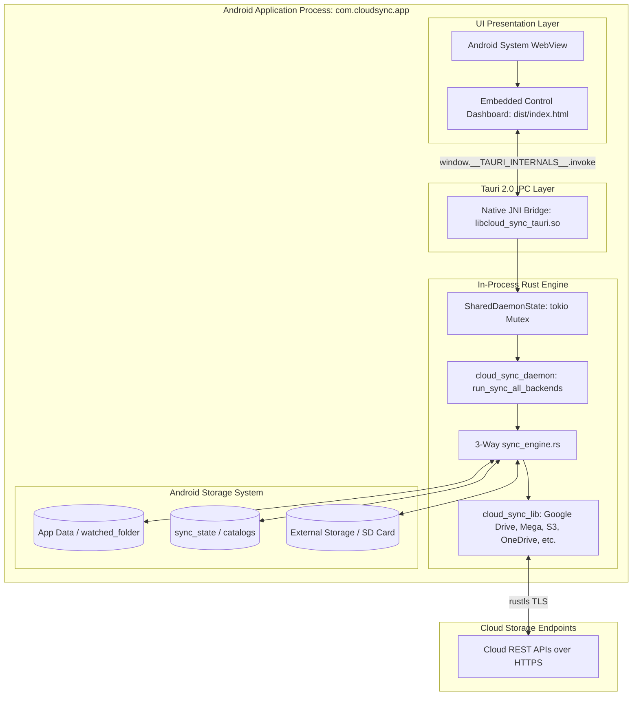

# Android Client Guide: Architecture, Build & Deployment

This document details the Android mobile client architecture for Cloud Sync, covering the in-process execution model, system permissions, prerequisites, and build/deployment workflows using Tauri 2.0.

---

## 1. Architecture Overview

Unlike the desktop environment where `cloud_sync_daemon` runs as a persistent external binary communicating over a localhost TCP socket (`:8081`), the **Android Client operates entirely in-process**:



### Key Architectural Characteristics
- **Zero Localhost Networking**: Commands (`status`, `sync`, `pause`, `resume`, `conflicts`, `resolve_conflict`) execute directly in-process via Tauri IPC commands (`crates/cloud_sync_tauri/src/commands.rs`).
- **TLS Security**: Network calls use `reqwest` backed by `rustls` and Mozilla's `webpki-roots`, requiring no external C OpenSSL libraries on Android.
- **Offline Self-Contained UI**: Assets are bundled directly into the APK in `dist/index.html` (no local HTTP server needed).
- **Graceful Scoped Storage**: Resolves files inside the Android app private storage directory (`/data/user/0/com.cloudsync.app/files/watched_folder/`) by default, with optional external storage access via Android permissions.

---

## 2. Android System Permissions

The Android client requests the following permissions in `AndroidManifest.xml`:

| Permission | Purpose |
| :--- | :--- |
| `android.permission.INTERNET` | Required for all cloud provider API calls (Google Drive, MEGA, OneDrive, S3, etc.). |
| `android.permission.ACCESS_NETWORK_STATE` | Allows the sync scheduler to monitor Wi-Fi vs. cellular connectivity. |
| `android.permission.FOREGROUND_SERVICE` | Keeps the synchronization thread active during long-running background sync passes. |
| `android.permission.POST_NOTIFICATIONS` | Displays active sync progress and conflict alert notifications on Android 13+. |
| `android.permission.MANAGE_EXTERNAL_STORAGE` | *(Optional)* Grants "All Files Access" to synchronize arbitrary folders on `/storage/emulated/0/`. |

---

## 3. Development Prerequisites

To compile the Android client, ensure the following tools are installed:

1. **Android Studio & SDK**:
   - Android SDK Platform 34 (Android 14) or newer.
   - Android NDK (r25c or newer).
   - Set environment variables:
     ```powershell
     $env:ANDROID_HOME = "C:\Users\<User>\AppData\Local\Android\Sdk"
     $env:NDK_HOME = "$env:ANDROID_HOME\ndk\<version>"
     ```

2. **Java Development Kit (JDK)**:
   - JDK 17 (recommended: Eclipse Temurin or Android Studio bundled JBR).
     ```powershell
     $env:JAVA_HOME = "C:\Program Files\Android\Android Studio\jbr"
     ```

3. **Rust Android Targets**:
   Install the compilation targets for Android architectures:
   ```bash
   rustup target add aarch64-linux-android
   rustup target add armv7-linux-androideabi
   rustup target add x86_64-linux-android
   rustup target add i686-linux-android
   ```

4. **Tauri CLI**:
   ```bash
   cargo install tauri-cli --version "^2.0" --locked
   ```

---

## 4. Building and Running

### 4.1 Initialize Android Project Files
Run the initialization command once inside `crates/cloud_sync_tauri`:
```bash
cd crates/cloud_sync_tauri
cargo tauri android init
```
This generates the Gradle project under `crates/cloud_sync_tauri/gen/android/` with `MainActivity.kt` pre-configured to load `libcloud_sync_tauri.so`.

### 4.2 Run in Live Development Mode (Emulator or Device)
Connect an Android device with USB Debugging enabled (or start an AVD emulator), then execute:
```bash
cargo tauri android dev
```
Tauri will:
1. Compile the Rust library for the target architecture (`aarch64` or `x86_64`).
2. Package the web assets from `dist/`.
3. Build the APK and install it on the connected device.
4. Stream `adb logcat` output directly to the terminal.

### 4.3 Build Release APK
To generate a release APK:
```bash
cargo tauri android build --apk
```
The compiled APK will be located at:
```
crates/cloud_sync_tauri/gen/android/app/build/outputs/apk/release/app-release-unsigned.apk
```

---

## 5. Testing and Diagnostics

### 5.1 Verifying IPC Commands Locally
You can test that all Tauri commands compile and execute on desktop without launching the sidecar:
```bash
cargo test -p cloud_sync_tauri
```

### 5.2 Checking Android Logcat
To filter logs from the Cloud Sync Android client:
```bash
adb logcat -s "CloudSync:*" "RustStdoutStderr:*" "Tauri:*"
```
