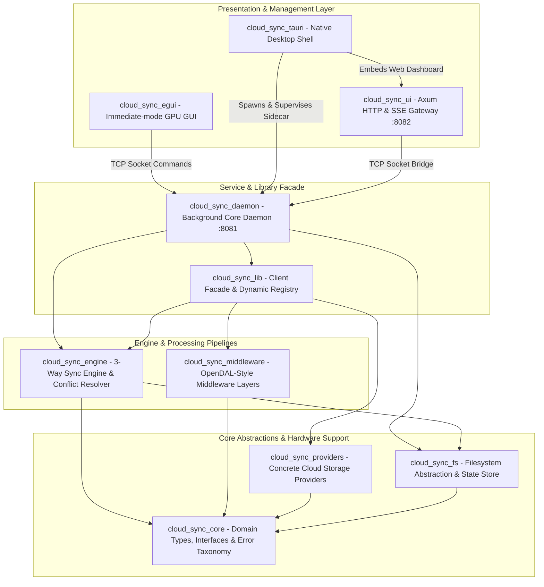
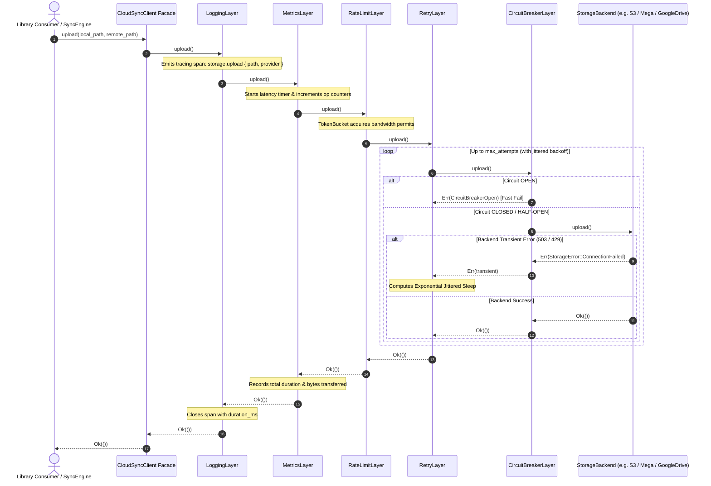
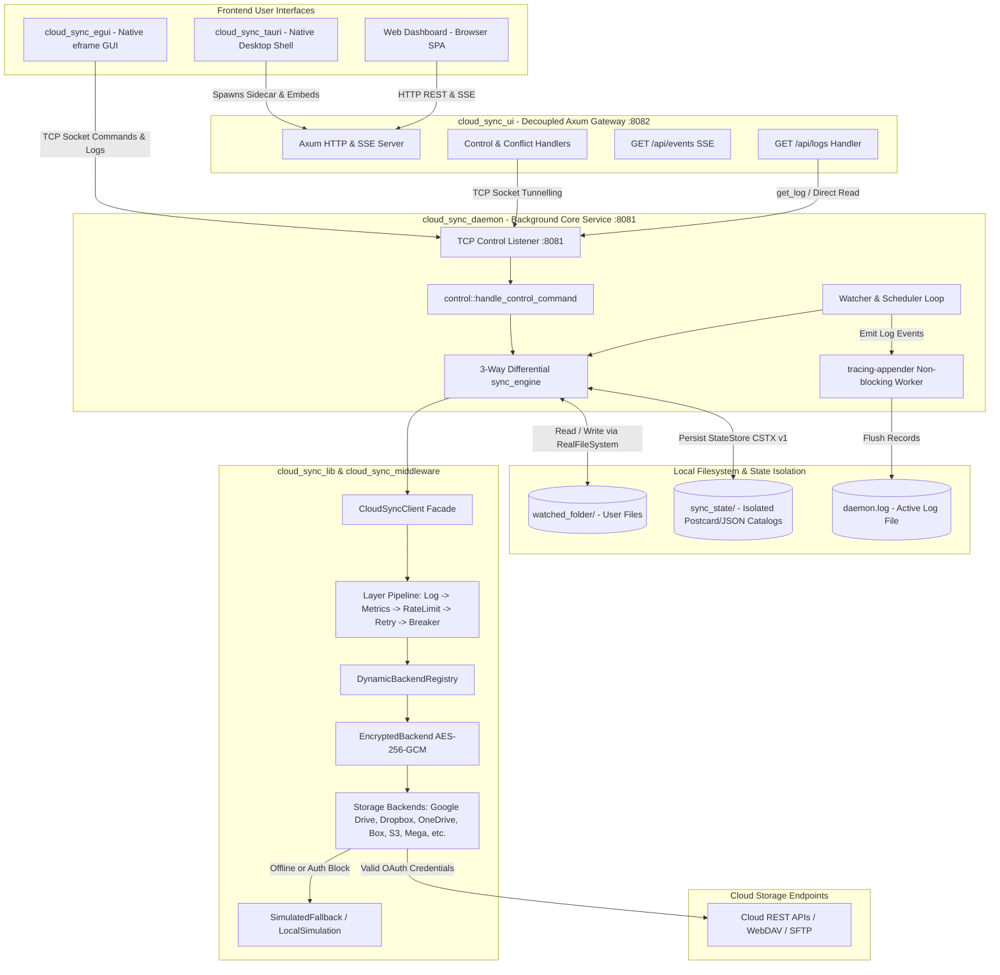

# Workspace Architecture

This document describes the modular architecture of the Cloud Sync ecosystem, detailing the 8-crate workspace organization, the OpenDAL-style layered middleware pipeline, the desktop interfaces (`cloud_sync_egui`, `cloud_sync_tauri`), the Axum Web UI gateway (`cloud_sync_ui`), the background daemon (`cloud_sync_daemon`), the isolated state catalog, the non-blocking observability pipeline, and the storage backend providers.

---

## Workspace Crate Topology

The repository is structured as an 8-crate Cargo workspace strictly enforcing separation of concerns, Single Responsibility, and Dependency Inversion:



### Crate Roles and Responsibilities

| Crate | Responsibility | Key Exports & Traits |
| :--- | :--- | :--- |
| [`cloud_sync_core`](../crates/cloud_sync_core/README.md) | Domain types, foundational error taxonomy, security wrappers, and core storage traits. Has minimal external dependencies. | `StorageBackend`, `StorageReader`, `StorageWriter`, `DirectoryLister`, `ServerSideOperations`, `ResumableUploader`, `NormalizedPath`, `StorageError`, `StorageItem`, `StorageCapabilities` |
| [`cloud_sync_fs`](../crates/cloud_sync_fs/README.md) | Filesystem abstraction, zero-copy buffer pooling, and pluggable sync catalog storage. | `FileSystem`, `RealFileSystem`, `MockFileSystem`, `BufferPool`, `PooledBuffer`, `StateStore`, `PostcardStateStore`, `JsonStateStore` |
| [`cloud_sync_middleware`](../crates/cloud_sync_middleware/README.md) | Composable, OpenDAL-style middleware decorators wrapping `StorageBackend` dynamically. | `StorageLayer`, `LayeredBackendExt`, `RetryLayer`, `CircuitBreakerLayer`, `RateLimitLayer`, `LoggingLayer`, `MetricsLayer` |
| [`cloud_sync_engine`](../crates/cloud_sync_engine/README.md) | 3-way synchronization differential algorithms, conflict resolution policies, and event interception hooks. | `SyncEngine`, `SyncPolicy`, `ConflictPolicy`, `SyncInterceptor`, `LoggingInterceptor`, `MetricsInterceptor`, `CompositeInterceptor` |
| [`cloud_sync_providers`](../crates/cloud_sync_providers/README.md) | 13 concrete cloud storage implementations, OAuth2 token refreshing, and mock harnesses. | `GoogleDriveProvider`, `DropboxProvider`, `OneDriveProvider`, `BoxProvider`, `S3Provider`, `AzureBlobProvider`, `GCSProvider`, `B2Provider`, `PCloudProvider`, `MegaProvider`, `NextcloudProvider`, `WebDAVProvider`, `SFTPProvider` |
| [`cloud_sync_lib`](../crates/cloud_sync_lib/README.md) | Consumer-facing client library facade, dynamic registry, credential parsing, and backward-compatible re-exports. | `CloudSyncClient`, `CloudSyncBuilder`, `DynamicBackendRegistry`, `BackendRegistry`, `SimulatedFallback` |
| [`cloud_sync_daemon`](../crates/cloud_sync_daemon/README.md) | Standalone background OS daemon listening on TCP port 8081, managing filesystem watchers (`notify`) and sync schedulers. | `daemon::run`, `control::handle_control_command`, `check_backends` CLI |
| [`cloud_sync_ui`](../crates/cloud_sync_ui/README.md) / `cloud_sync_egui` / `cloud_sync_tauri` | Desktop immediate-mode GUI, browser-based web dashboard (Axum on :8082 with SSE), and OS-native desktop shell. | Native desktop dashboards, status badges, log viewer modals, tray management |

---

## Layered Middleware Pipeline Architecture

`cloud_sync_lib` uses an OpenDAL-style composable onion architecture (`StorageLayer`) that wraps any storage backend without requiring inheritance or modifying provider code:



### Execution Order & Rationale
When building via `CloudSyncBuilder` or `LayeredBackendExt`:
1. **CircuitBreakerLayer (Innermost before Provider)**: Fails immediately when the backend is experiencing sustained outages, preventing unnecessary retry storms.
2. **RetryLayer**: Retries transient errors (`is_transient()`) with truncated exponential backoff and randomized full-jitter math ($Sleep = \text{random}(0, \min(M, B \cdot 2^{\text{attempt}}))$).
3. **RateLimitLayer**: Token-bucket bandwidth regulation governing inbound and outbound bytes per second.
4. **MetricsLayer**: Aggregates latency distributions, transfer volumes, and error rates via thread-safe atomic counters.
5. **LoggingLayer (Outermost)**: Emits structured OpenTelemetry-compatible tracing spans around the entire request lifecycle.

---

## High-Level System Architecture Diagram



---

## Synchronization Engine & Interceptors

The 3-way synchronization engine in `cloud_sync_engine` coordinates changes between the Base snapshot ($B$), the Local filesystem ($L$), and the Remote cloud backend ($R$):

$$\Delta = \text{Evaluate}(B, L, R)$$

### Sync Interceptor Pipeline

Lifecycle hooks are exposed through the `SyncInterceptor` trait, allowing telemetry, custom auditing, or external webhooks to fire without coupling to the sync loop:

- `on_sync_start(&self)`
- `before_operation(&self, item: &StorageItem, action: SyncAction) -> InterceptorDecision`
- `after_operation(&self, item: &StorageItem, action: SyncAction, result: &Result<(), StorageError>)`
- `on_conflict(&self, item: &StorageItem, resolution: ConflictResolution)`
- `on_sync_complete(&self, summary: &SyncSummary)`

Interceptors can be chained using `CompositeInterceptor`, combining `LoggingInterceptor` and `MetricsInterceptor`.

---

## State Management & Catalog Isolation

To prevent watcher recursion, directory clutter, and accidental cloud uploads, synchronization catalogs are isolated from user files:

```
cloud_sync_lib/
├── sync_state/                        <-- Dedicated state directory
│   ├── .sync_state_Google_Drive.bin    <-- Binary catalog (Postcard with CSTX v1 header)
│   ├── .sync_state_Google_Drive.json   <-- Human-readable JSON catalog
│   └── .sync_state_Google_Drive.bak    <-- Atomic write crash backup
└── watched_folder/                     <-- Clean user directory
    └── documents/
```

- **Separation of Concerns**: User documents remain clean and untainted by internal synchronization metadata.
- **Watcher Protection**: Writing state updates never triggers false-positive modification events in `notify`.
- **Atomic Two-Phase Commits**: State files are saved with `.bak` backups and temporary atomic renames (`.tmp` $\to$ final) to prevent state corruption during sudden OS reboots.
- **Pluggable Formats**: Implemented via `StateStore` with default `PostcardStateStore` (compact binary format protected by CRC32 checksum) and `JsonStateStore` (diagnostic inspection).

---

## Security & Path Normalization

All storage operations sanitize incoming user and provider paths using the `NormalizedPath` newtype:
- Verifies UTF-8 compliance.
- Replaces backslashes (`\`) with standard forward slashes (`/`).
- Strips redundant `./` components.
- Completely forbids parent directory traversals (`../`) to guarantee sandbox isolation and prevent directory traversal vulnerabilities.

---

## Related Architectural References

- 📘 [Client Library API Reference](CLIENT_API.md)
- 🔒 [Security & Reliability Guide](SECURITY_AND_RELIABILITY.md)
- 🗄️ [State Catalog & Storage Architecture](STATE_AND_STORAGE.md)
- 📊 [Logging & Diagnostics Architecture](LOGGING_AND_DIAGNOSTICS.md)
- 🔍 [Diagnostics & Verifiers Reference](DIAGNOSTICS_AND_VERIFIERS.md)
- 🧩 [Extending Providers & Testing](EXTENDING_AND_TESTING.md)
- 🛠️ [Troubleshooting & Operations Guide](TROUBLESHOOTING.md)
