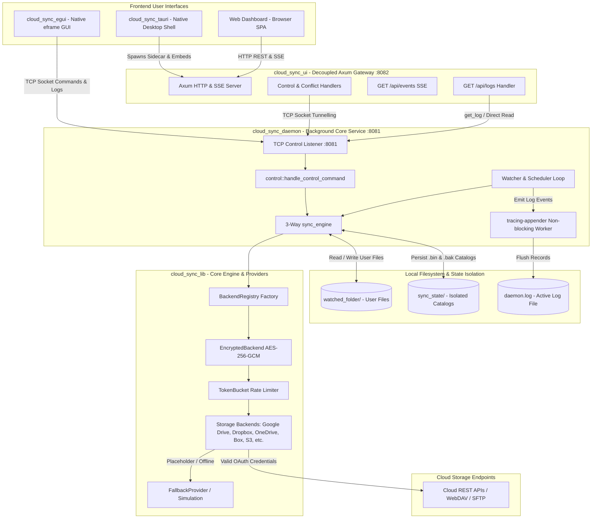

# Workspace Architecture

This document describes the modular architecture of the Cloud Sync workspace, detailing the interaction between the desktop interfaces (`cloud_sync_egui`, `cloud_sync_tauri`), the decoupled Axum Web UI (`cloud_sync_ui`), the background daemon (`cloud_sync_daemon`), the isolated state catalog, the non-blocking logging pipeline, and the storage backend provider libraries.

---

## High-Level Architecture Diagram



---

## Core Components

### 1. `cloud_sync_egui` (Native Desktop Client)
- **Immediate-Mode Desktop GUI**: Built using `egui 0.27` and `eframe`, executing at native GPU-accelerated framerates.
- **Asynchronous Tokio Bridge**: Offloads network socket traffic and log retrieval to a decoupled Tokio background threadpool.
- **Diagnostics & Operations**: Features status badges, operations center (Start, Stop, Pause, Resume, Sync, Reload), in-app modal log viewer, and OS text editor launching without file-sharing locks.
- **Windowless Windows Subsystem**: Compiles with `#![windows_subsystem = "windows"]` and `CREATE_NO_WINDOW` flags to eliminate console windows.

### 2. `cloud_sync_ui` (Decoupled Axum Gateway)
- **Decoupled API Server**: An Axum HTTP server running on port `8082`. Translates REST endpoints (`/api/status`, `/api/start`, `/api/pause`, `/api/sync`, `/api/stop`, `/api/conflicts/resolve`) into TCP socket commands for the daemon.
- **Embedded Web Dashboard**: Compiles frontend assets (`index.html`, CSS, JS) directly into the binary.
- **Plaintext Log Stream**: Exposes `/api/logs` which queries the daemon via `get_log` or falls back to reading the local disk log if the daemon is offline.
- **Server-Sent Events (SSE)**: Streams live file synchronization telemetry to connected browser clients at `/api/events`.

### 3. `cloud_sync_tauri` (Cross-Platform Desktop Shell)
- **Application Wrapper**: Wraps the `cloud_sync_ui` web dashboard in a native desktop window framework.
- **Sidecar Lifecycle**: Automatically spawns and supervises `cloud_sync_daemon` as a managed sidecar child process with argument forwarding.
- **Auto-Launch Persistence**: Automatically registers the application to start on OS boot via the `auto-launch` crate.

### 4. `cloud_sync_daemon` (Core Service)
- **Configuration Parsing**: Reads and validates `config.toml` or `private_config.toml` into `AppConfig`.
- **Filesystem Event Monitoring**: Employs the `notify` crate to detect additions, modifications, and deletions in the watched directory.
- **TCP Control Socket**: Listens on port `8081` for control commands (`status`, `get_log`, `sync`, `pause`, `resume`, `reload`, `stop`).
- **3-Way Synchronization Engine**: Evaluates Base snapshot ($B$), Local ($L$), and Remote ($R$) states to execute non-ambiguous uploads, downloads, and deletions.

---

## 5. State Management & Catalog Isolation

To prevent watcher recursion, directory clutter, and accidental cloud uploads, synchronization catalogs are isolated from user files:

```
cloud_sync_lib/
├── sync_state/                        <-- Dedicated state directory
│   ├── .sync_state_Google_Drive.bin    <-- Active binary catalog (bincode)
│   └── .sync_state_Google_Drive.bak    <-- Atomic write crash backup
└── watched_folder/                     <-- Clean user directory
    └── documents/
```

- **Separation of Concerns**: User documents remain clean and untainted by hidden internal metadata files.
- **Watcher Protection**: Writing state updates never triggers false-positive modification events in `notify`.
- **Two-Phase Atomic Commit**: State files are saved with `.bak` backups and temporary atomic renames to prevent corruption during unexpected shutdowns.
- **Startup Migration**: Older `.sync_state` databases found in `watch_directory` are automatically discovered and migrated into `sync_state/` on daemon boot.

---

## 6. Observability & Logging Architecture

The daemon implements a dual-sink, non-blocking observability architecture:

- **Stdout Sink**: Colorized terminal output for interactive developer runs.
- **Non-Blocking File Sink**: Managed by `tracing_appender::rolling::never`, piping tracing events through an asynchronous worker thread to disk (`daemon.log`).
- **Multi-Interface Access**:
  - Direct file inspection via `tail` or PowerShell `Get-Content`.
  - Daemon TCP command: `get_log`.
  - Axum REST endpoint: `GET /api/logs`.
  - Native modal in `cloud_sync_egui` with external editor integration.

---

## 7. Storage Backend Providers (`cloud_sync_lib`)

All storage backends implement the `StorageBackend` trait defined in [`cloud_sync_core`](../crates/cloud_sync_core/README.md):

- **Cloud APIs**: Google Drive, Dropbox, Microsoft OneDrive, Box, Backblaze B2, pCloud, AWS S3, Azure Blob, Google Cloud Storage, MEGA, IPFS.
- **Network Protocols**: WebDAV, Nextcloud (WebDAV + OCS), SFTP.
- **Feature Wrappers**:
  - `EncryptedBackend`: Zero-knowledge client-side AES-256-GCM encryption with PBKDF2 key derivation.
  - `TokenBucket`: Bandwidth rate limiter for download/upload ceilings.
  - `FallbackProvider`: In-memory and directory simulation fallback when credentials are absent or invalid.

---

## 8. Related Architectural References

- 📘 [Logging & Diagnostics Architecture](LOGGING_AND_DIAGNOSTICS.md)
- 🗄️ [State Catalog & Storage Architecture](STATE_AND_STORAGE.md)
- 🛠️ [Troubleshooting & Operations Guide](TROUBLESHOOTING.md)
- 📖 [User Guide](USER_GUIDE.md)
