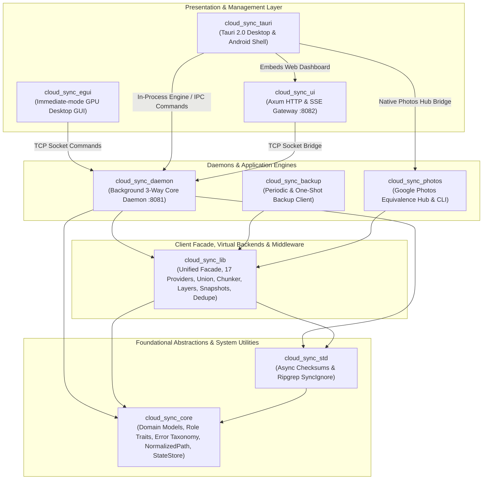
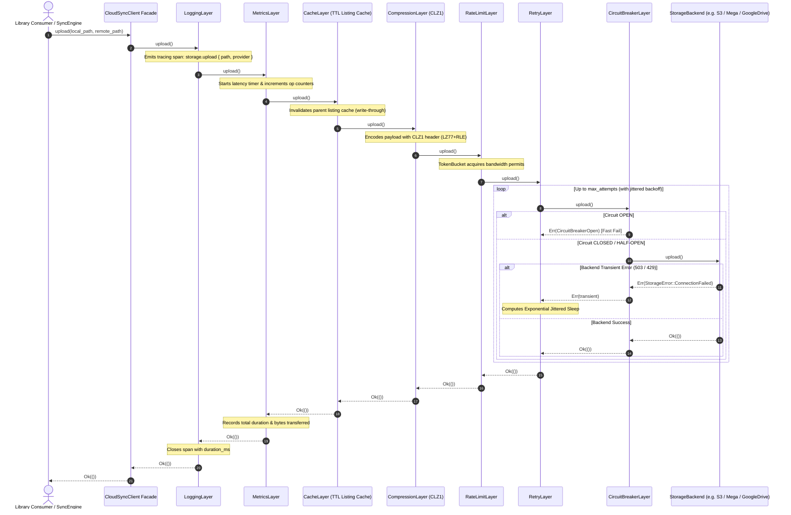
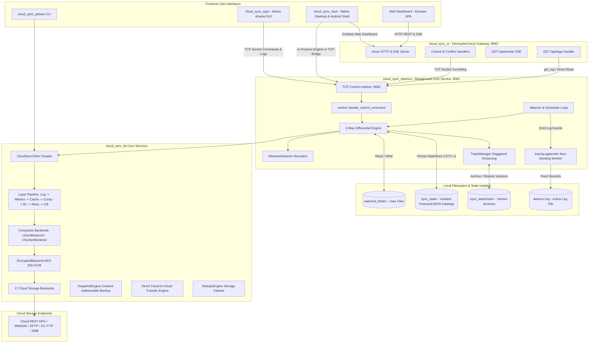

# Workspace Architecture

This document describes the modular architecture of the Cloud Sync ecosystem, detailing the 9-crate workspace organization, the OpenDAL-style layered middleware pipeline, the desktop and mobile interfaces (`cloud_sync_egui`, `cloud_sync_tauri`), the Axum Web UI gateway (`cloud_sync_ui`), the background daemon (`cloud_sync_daemon`), the media hub (`cloud_sync_photos`), the unidirectional backup daemon (`cloud_sync_backup`), the standard utility library (`cloud_sync_std`), and the isolated state catalog.

---

## Workspace Crate Topology

The repository is structured as a 9-crate Cargo workspace strictly enforcing separation of concerns, Single Responsibility, and Dependency Inversion:



### Crate Roles and Responsibilities

| Crate | Responsibility | Key Exports & Traits |
| :--- | :--- | :--- |
| **[`cloud_sync_core`](file:///C:/Projects/cloud_sync_lib/crates/cloud_sync_core/README.md)** | Zero-dependency, `no_std`-compatible domain types, granular storage role traits, error taxonomy, `NormalizedPath` security newtype, and `StateStore` persistence trait. | `StorageBackend`, `StorageReader`, `StorageWriter`, `DirectoryLister`, `FolderOps`, `ServerSideOperations`, `ResumableUploader`, `NormalizedPath`, `StorageError`, `StorageItem`, `StorageCapabilities`, `StateStore`, `PostcardStateStore`, `JsonStateStore` |
| **[`cloud_sync_std`](file:///C:/Projects/cloud_sync_lib/crates/cloud_sync_std/README.md)** | Standard library utilities, non-blocking asynchronous cryptographic checksum hashers, and Ripgrep-based ignore pattern engine. | `compute_sha256`, `compute_md5`, `compute_crc32`, `SyncIgnore` |
| **[`cloud_sync_lib`](file:///C:/Projects/cloud_sync_lib/crates/cloud_sync_lib/README.md)** | High-level consumer client facade (`CloudSyncClient`), 17 concrete cloud storage providers, virtual backends (`UnionBackend`, `ChunkerBackend`, `EncryptedBackend`), composable middleware layers, zero-copy buffer pool, snapshot engine, deduplication, analytics, and cloud-to-cloud transfer. | `CloudSyncClient`, `CloudSyncBuilder`, `DynamicBackendRegistry`, `UnionBackend`, `ChunkerBackend`, `CompressionLayer`, `CacheLayer`, `RetryLayer`, `CircuitBreakerLayer`, `RateLimitLayer`, `MetricsLayer`, `LoggingLayer`, `SnapshotEngine`, `transfer_between_backends`, `BufferPool` |
| **[`cloud_sync_daemon`](file:///C:/Projects/cloud_sync_lib/crates/cloud_sync_daemon/README.md)** | Long-running OS daemon watching local directories with `notify`, 3-way synchronization orchestrator (`SyncPlanner`, `SyncExecutor`), rename/move detection (`RenameDetector`), staggered file versioning (`TrashManager`), and TCP control socket (`127.0.0.1:8081`). | `daemon::run`, `control::handle_control_command`, `SyncPlanner`, `SyncExecutor`, `RenameDetector`, `TrashManager`, `check_backends` CLI |
| **[`cloud_sync_photos`](file:///C:/Projects/cloud_sync_lib/crates/cloud_sync_photos/README.md)** | Self-contained Google Photos equivalence engine with pure-Rust EXIF metadata extraction, chronological timeline organization, SHA-256 deduplication, Haversine GPS search, virtual albums, and standalone CLI. | `PhotoLibrary`, `OrganizeStrategy`, `PhotoMetadata`, `ExifData`, `GeoLocation`, `SearchFilter`, `cloud_sync_photos` CLI |
| **[`cloud_sync_backup`](file:///C:/Projects/cloud_sync_lib/crates/cloud_sync_backup/README.md)** | Dedicated background service and CLI for unidirectional periodic or one-shot backups across all 17 storage providers with smart change detection. | `backup_main`, `BackupConfig`, `run_backup_pass` |
| **[`cloud_sync_ui`](file:///C:/Projects/cloud_sync_lib/crates/cloud_sync_ui/README.md)** | Decoupled Axum HTTP REST and Server-Sent Events (SSE) server listening on `:8082`, serving embedded SPA management dashboard and bridging web actions to daemon TCP socket. | `start_ui_server`, `UiState`, `/api/status`, `/api/events`, `/api/logs`, `/api/conflicts` |
| **[`cloud_sync_egui`](file:///C:/Projects/cloud_sync_lib/crates/cloud_sync_egui/README.md)** | Native GPU-accelerated desktop GUI built on `egui` and `eframe` with 60 FPS update loop, Tokio background runtime, log viewer modal, and offline self-start. | `CloudSyncApp`, `run_native_gui` |
| **[`cloud_sync_tauri`](file:///C:/Projects/cloud_sync_lib/crates/cloud_sync_tauri/README.md)** | Cross-platform desktop and mobile (Android) application shell powered by Tauri 2.0, supporting both desktop sidecar management and mobile in-process sync. | Tauri IPC commands (`status`, `sync`, `pause`, `resume`, `conflicts`), mobile entry points, Photos Hub view |

---

## Layered Middleware Pipeline Architecture

`cloud_sync_lib` uses an OpenDAL-style composable onion architecture (`StorageLayer`) that wraps any storage backend without requiring inheritance or modifying provider code:



### Execution Order & Rationale
When building via `CloudSyncBuilder` or `LayeredBackendExt`:
1. **CircuitBreakerLayer (Innermost before Provider)**: Fails immediately when the backend is experiencing sustained outages, preventing unnecessary retry storms.
2. **RetryLayer**: Retries transient errors (`is_transient()`) with truncated exponential backoff and randomized full-jitter math ($Sleep = \text{random}(0, \min(M, B \cdot 2^{\text{attempt}}))$).
3. **RateLimitLayer**: Token-bucket bandwidth regulation governing inbound and outbound bytes per second.
4. **CompressionLayer**: Transparent `CLZ1` lossless compression for uploaded files and automatic decompression on download.
5. **CacheLayer**: In-memory metadata and directory listing cache with configurable TTL and write-through invalidation.
6. **MetricsLayer**: Aggregates latency distributions, transfer volumes, and error rates via thread-safe atomic counters.
7. **LoggingLayer (Outermost)**: Emits structured OpenTelemetry-compatible tracing spans around the entire request lifecycle.

---

## High-Level System Architecture Diagram



---

## Synchronization Engine, Rename Detection & Versioning

The 3-way synchronization engine in `cloud_sync_daemon` coordinates changes between the Base snapshot ($B$), the Local filesystem ($L$), and the Remote cloud backend ($R$):

$$\Delta = \text{Evaluate}(B, L, R)$$

### 1. Heuristic Rename & Move Detection (`RenameDetector`)
When files are renamed or moved across directories:
- Standard sync engines treat the change as a destructive deletion followed by an upload.
- `RenameDetector` inspects pending deletions and additions, matching entries using content checksums and file sizes.
- Matches are converted into efficient server-side rename/move operations where supported, saving network bandwidth.

### 2. Staggered File Versioning (`TrashManager`)
- Before any file overwrite or deletion takes place, the existing file is safely archived to `sync_state/trash/` using timestamp formatting: `YYYYMMDD_HHMMSS_<filename>`.
- Preserves point-in-time file recovery.
- Automatically enforces retention bounds (`retention_days` and `max_versions_per_file`).

---

## State Management & Catalog Isolation

To prevent watcher recursion, directory clutter, and accidental cloud uploads, synchronization catalogs are isolated from user files:

```
cloud_sync_lib/
├── sync_state/                        <-- Dedicated state directory
│   ├── .sync_state_Google_Drive.bin    <-- Binary catalog (Postcard with CSTX v1 header & CRC32)
│   ├── .sync_state_Google_Drive.json   <-- Human-readable JSON catalog
│   ├── .sync_state_Google_Drive.bak    <-- Atomic write crash backup
│   └── trash/                         <-- Staggered file versioning archive
└── watched_folder/                     <-- Clean user directory
    └── documents/
```

- **Separation of Concerns**: User documents remain clean and untainted by internal synchronization metadata.
- **Watcher Protection**: Writing state updates never triggers false-positive modification events in `notify`.
- **Atomic Two-Phase Commits**: State files are saved with `.bak` backups and temporary atomic renames (`.tmp` $\to$ final) to prevent state corruption during sudden OS reboots.
- **Pluggable Formats**: Implemented via `StateStore` with default `PostcardStateStore` (compact binary format protected by CRC32 checksum) and `JsonStateStore` (diagnostic inspection).

---

## Related Architectural References

- 📸 [Google Photos Equivalence Hub Guide](PHOTOS_HUB.md)
- 🔀 [Virtual Backends & Middleware Layers Guide](VIRTUAL_BACKENDS_AND_LAYERS.md)
- 🧰 [Operational Tools & Disaster Recovery Guide](OPERATIONAL_TOOLS.md)
- 📘 [Client Library API Reference](CLIENT_API.md)
- 📱 [Android Client Guide](ANDROID_CLIENT.md)
- 🔒 [Security & Reliability Guide](SECURITY_AND_RELIABILITY.md)
- 🗄️ [State Catalog & Storage Architecture](STATE_AND_STORAGE.md)
- 📊 [Logging & Diagnostics Architecture](LOGGING_AND_DIAGNOSTICS.md)
- 🔍 [Diagnostics & Verifiers Reference](DIAGNOSTICS_AND_VERIFIERS.md)
- 🧩 [Extending Providers & Testing](EXTENDING_AND_TESTING.md)
- 🛠️ [Troubleshooting & Operations Guide](TROUBLESHOOTING.md)
