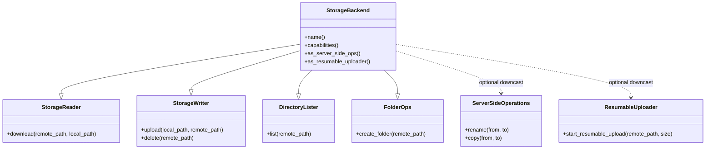

# Extending CloudSync & Testing Guide

This guide describes how to implement custom storage providers, extend the layered middleware architecture, use granular role traits, register dynamic backends, and run compliance test suites.

---

## 1. Granular Role Traits (Interface Segregation)

Instead of a monolithic trait with mandatory empty stubs, `cloud_sync_core` separates storage capabilities into fine-grained role traits:



### Implementing a Custom Storage Provider

Here is an example implementing an in-memory key-value storage backend:

```rust,no_run
use async_trait::async_trait;
use cloud_sync_core::{
    FolderOps, NormalizedPath, ServerSideOperations, StorageBackend, StorageCapabilities,
    StorageError, StorageItem, StorageReader, StorageWriter, DirectoryLister
};
use std::collections::HashMap;
use std::path::Path;
use std::sync::RwLock;

pub struct MemoryStorageBackend {
    files: RwLock<HashMap<String, Vec<u8>>>,
}

impl MemoryStorageBackend {
    pub fn new() -> Self {
        Self {
            files: RwLock::new(HashMap::new()),
        }
    }
}

#[async_trait]
impl StorageReader for MemoryStorageBackend {
    async fn download(&self, remote_path: &str, local_path: &Path) -> Result<(), StorageError> {
        let norm = NormalizedPath::new(remote_path).map_err(|e| StorageError::InvalidPath(e.into()))?;
        let files = self.files.read().map_err(|_| StorageError::Provider {
            message: "Lock poisoned".into(),
            status: None,
        })?;
        if let Some(bytes) = files.get(norm.as_str()) {
            tokio::fs::write(local_path, bytes).await.map_err(StorageError::Io)?;
            Ok(())
        } else {
            Err(StorageError::NotFound(remote_path.to_string()))
        }
    }
}

#[async_trait]
impl StorageWriter for MemoryStorageBackend {
    async fn upload(&self, local_path: &Path, remote_path: &str) -> Result<(), StorageError> {
        let norm = NormalizedPath::new(remote_path).map_err(|e| StorageError::InvalidPath(e.into()))?;
        let bytes = tokio::fs::read(local_path).await.map_err(StorageError::Io)?;
        let mut files = self.files.write().map_err(|_| StorageError::Provider {
            message: "Lock poisoned".into(),
            status: None,
        })?;
        files.insert(norm.as_str().to_string(), bytes);
        Ok(())
    }

    async fn delete(&self, remote_path: &str) -> Result<(), StorageError> {
        let norm = NormalizedPath::new(remote_path).map_err(|e| StorageError::InvalidPath(e.into()))?;
        let mut files = self.files.write().map_err(|_| StorageError::Provider {
            message: "Lock poisoned".into(),
            status: None,
        })?;
        files.remove(norm.as_str());
        Ok(())
    }
}

#[async_trait]
impl DirectoryLister for MemoryStorageBackend {
    async fn list(&self, remote_path: &str) -> Result<Vec<StorageItem>, StorageError> {
        let files = self.files.read().map_err(|_| StorageError::Provider {
            message: "Lock poisoned".into(),
            status: None,
        })?;
        let items = files.iter().map(|(path, data)| {
            StorageItem {
                path: std::path::PathBuf::from(path),
                size: data.len() as u64,
                modified: 0,
                is_dir: false,
                checksum: None,
            }
        }).collect();
        Ok(items)
    }
}

#[async_trait]
impl FolderOps for MemoryStorageBackend {
    async fn create_folder(&self, _remote_path: &str) -> Result<(), StorageError> {
        Ok(()) // In-memory virtual hierarchy
    }
}

#[async_trait]
impl StorageBackend for MemoryStorageBackend {
    fn name(&self) -> &str {
        "in_memory"
    }

    fn capabilities(&self) -> StorageCapabilities {
        StorageCapabilities::NONE
    }
}
```

---

## 2. Registering with `DynamicBackendRegistry`

Custom providers can be registered dynamically at runtime without modifying the library:

```rust,no_run
use cloud_sync_lib::{BackendFactory, DynamicBackendRegistry, StorageBackend, StorageError};
use serde_json::Value as JsonValue;
use std::path::PathBuf;
use std::sync::Arc;

struct MemoryFactory;

impl BackendFactory for MemoryFactory {
    fn create(&self, config: &JsonValue, _sim_root: PathBuf) -> Result<Arc<dyn StorageBackend>, StorageError> {
        Ok(Arc::new(MemoryStorageBackend::new()))
    }
}

fn register_custom() {
    let mut registry = DynamicBackendRegistry::with_defaults();
    registry.register("memory", Arc::new(MemoryFactory));
}
```

---

## 3. Creating Custom Middleware Layers

To create a new middleware layer, implement the `StorageLayer` trait:

```rust,no_run
use cloud_sync_lib::layers::StorageLayer;
use cloud_sync_core::{StorageBackend, StorageCapabilities, StorageError};
use std::sync::Arc;
use std::path::Path;

pub struct AuditLayer {
    audit_tag: String,
}

impl StorageLayer for AuditLayer {
    fn layer(&self, backend: Arc<dyn StorageBackend>) -> Arc<dyn StorageBackend> {
        Arc::new(AuditBackend {
            inner: backend,
            tag: self.audit_tag.clone(),
        })
    }
}

struct AuditBackend {
    inner: Arc<dyn StorageBackend>,
    tag: String,
}

#[async_trait::async_trait]
impl StorageBackend for AuditBackend {
    fn name(&self) -> &str {
        self.inner.name()
    }

    fn capabilities(&self) -> StorageCapabilities {
        self.inner.capabilities()
    }

    async fn upload(&self, local_path: &Path, remote_path: &str) -> Result<(), StorageError> {
        println!("[AUDIT {}] Uploading {} -> {}", self.tag, local_path.display(), remote_path);
        self.inner.upload(local_path, remote_path).await
    }

    async fn download(&self, remote_path: &str, local_path: &Path) -> Result<(), StorageError> {
        self.inner.download(remote_path, local_path).await
    }

    async fn delete(&self, remote_path: &str) -> Result<(), StorageError> {
        self.inner.delete(remote_path).await
    }

    async fn list(&self, remote_path: &str) -> Result<Vec<cloud_sync_core::StorageItem>, StorageError> {
        self.inner.list(remote_path).await
    }
}
```

---

## 4. Contract Compliance Verification Suite

Any new `StorageBackend` implementation can be validated against the formal contract compliance suite in `cloud_sync_core::testing`:

```rust,no_run
use cloud_sync_core::testing::verify_backend_compliance;
use std::sync::Arc;

#[tokio::test]
async fn test_provider_contract_compliance() {
    let backend = Arc::new(MemoryStorageBackend::new());
    
    // Runs automated assertions:
    // 1. Path traversal rejection ('..', './')
    // 2. Non-existent file download returning StorageError::NotFound
    // 3. Roundtrip upload and download integrity check
    // 4. Remote deletion cleanup
    verify_backend_compliance(backend).await.expect("Provider failed compliance test suite");
}
```

