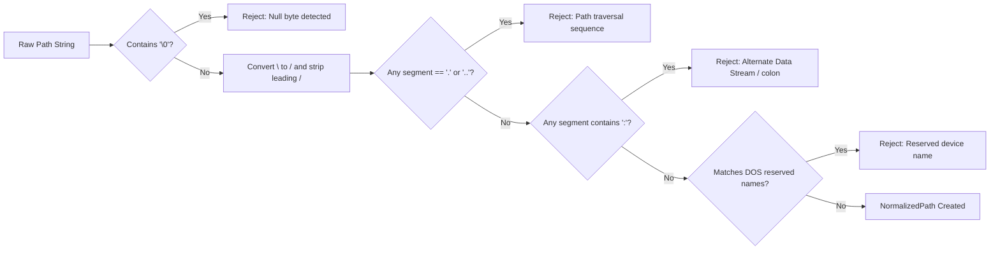
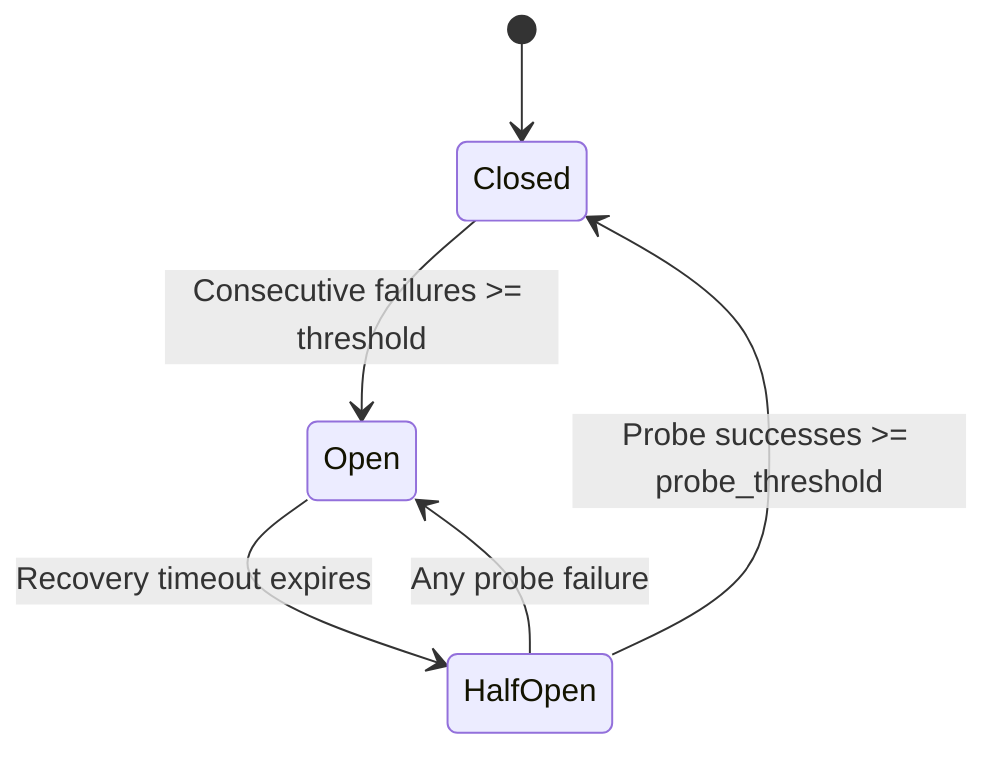

# Security & Reliability Engineering Guide

This document details the security principles, cryptographic architectures, memory zeroization practices, and reliability models implemented across the `cloud_sync_lib` ecosystem.

---

## 1. Security Architecture

### 1.1 Zero-Knowledge Client-Side Encryption (`EncryptedBackend`)
When enabled, data is encrypted on the client device before transmission to the cloud provider, ensuring the remote host only ever receives encrypted ciphertext.

#### Cryptographic Primitives & Structure
- **Algorithm**: Authenticated Encryption with Associated Data (AEAD) using **AES-256-GCM**.
- **Key Derivation**: PBKDF2-HMAC-SHA256 with **100,000 iterations** using a cryptographically random per-file 16-byte salt generated via `rand::thread_rng()`.
- **Chunked Streaming**: Files are processed in 64 KiB chunks (`CHUNK_SIZE = 65,536 bytes`). Each chunk is encrypted independently with its own nonce derived from a per-file 8-byte base nonce and monotonic chunk index:
  
  $$\text{Nonce}_i = \text{BaseNonce} \mathbin{\Vert} \text{to\_be\_bytes}(i)$$

- **Archive Binary Layout**:
  ```
  +--------------+--------------+------------------+------------------+-----------------------+
  | Magic (4B)   | Version (1B) | File Salt (16B)  | Base Nonce (8B)  | Encrypted Chunks ...  |
  | b"CSYC"      | 0x01         | Random Salt      | Random Nonce     | 64KB Ciphertext + Tag |
  +--------------+--------------+------------------+------------------+-----------------------+
  ```

---

### 1.2 Memory Protection & Token Zeroization
Sensitive cryptographic material and authentication tokens are actively wiped from process memory when no longer required to prevent heap-scraping attacks and accidental exposure in memory core dumps:

- **Key Zeroization**: AES key buffers derived in `derive_file_key()` call `.zeroize()` immediately after constructing cipher contexts:
  ```rust
  let mut key_bytes = [0u8; 32];
  ring::pbkdf2::derive(..., &mut key_bytes);
  let key = *Key::<Aes256Gcm>::from_slice(&key_bytes);
  key_bytes.zeroize();
  ```
- **OAuth Token Management**: `zeroize::Zeroizing<String>` protects raw access tokens and refresh tokens in memory.
- **Secret Redaction**: Data types containing passwords, client secrets, API tokens, and private keys implement custom `std::fmt::Debug` formatters that mask sensitive fields with `[REDACTED]` rather than printing secret strings.

---

### 1.3 Path Traversal Defenses (`NormalizedPath`)
All local and remote file operations sanitize incoming paths through the `NormalizedPath` newtype defined in [`cloud_sync_core`](file:///C:/Projects/cloud_sync_lib/crates/cloud_sync_core/src/path.rs):



- **Null Byte Elimination**: Prevents C-string null termination exploits.
- **Directory Traversal Rejection**: Paths containing `..` or `.` components are strictly rejected, preventing escapes outside the root directory sandbox.
- **Alternate Data Stream (ADS) Defense**: Segments containing colons (`:`) are prohibited to block hidden NTFS Alternate Data Stream attacks (e.g. `file.txt:stream`).
- **DOS Reserved Device Names**: Forbids Windows device names (`CON`, `PRN`, `AUX`, `NUL`, `COM1`–`COM9`, `LPT1`–`LPT9`) to prevent OS-level deadlocks and crashes.

---

## 2. Reliability & Resilience Engineering

### 2.1 Full-Jitter Exponential Backoff Math
Network operations are susceptible to thundering-herd issues when multiple clients retry against a recovering cloud backend simultaneously. `RetryLayer` implements AWS-standard **Full Jitter**:

$$\text{Ceiling} = \min\left(M, B \cdot 2^{\text{attempt} - 1}\right)$$

$$\text{SleepDuration} = \text{random}\left(0, \text{Ceiling}\right)$$

Where:
- $B$ is the base delay (default: `500ms`).
- $M$ is the maximum delay cap (default: `10s`).
- $\text{attempt}$ is the 1-based attempt counter.

If a provider responds with an explicit `Retry-After` HTTP header, `RetryLayer` prioritizes the server-requested duration.

---

### 2.2 Circuit Breaker State Machine
`CircuitBreakerLayer` isolates chronic outages and prevents thread pool starvation by fast-failing requests when a backend is down:



- **Closed**: All operations pass directly to the storage backend. Consecutive failures increment a counter.
- **Open**: Operations immediately fail with `StorageError::CircuitBreakerOpen` without making network calls.
- **Half-Open**: Once `recovery_timeout` (e.g. 15s) has elapsed, canary probe requests are permitted through. If probes succeed (`probe_success_threshold = 2`), the circuit resets to `Closed`. If any probe fails, it trips back to `Open`.

---

### 2.3 Bandwidth Rate Limiting (`TokenBucket`)
`RateLimitLayer` enforces separate upload and download throughput limits:
- **Token Bucket Algorithm**: Smooths out traffic spikes while allowing controlled short-term bursting.
- **Granular Throttling**: Regulates chunk transfers in `upload` and `download` streams to prevent saturating local broadband connections.

---

### 2.4 Error Classification & Recovery Matrix

`StorageError` provides semantic predicates that guide client decision-making:

| Predicate | Typical Error Causes | Recommended Action |
| :--- | :--- | :--- |
| `err.is_transient()` | HTTP 429, 500, 502, 503, 504, TCP timeout, connection reset | Auto-retried by `RetryLayer`. If exhausted, notify user or schedule background retry. |
| `err.is_auth()` | Expired token, invalid credentials, account blocked (`MEGA EBLOCKED -16`) | Re-authenticate, refresh OAuth tokens, or prompt user to verify account in browser. |
| `err.is_not_found()` | HTTP 404, missing remote file or parent directory | Re-scan remote listing, verify path spelling, or recreate folder hierarchy. |
| `err.is_conflict()` | Concurrent modification, checksum mismatch, ETag collision | Apply configured `ConflictPolicy` (`newer_wins`, `rename_both`, `manual`). |

