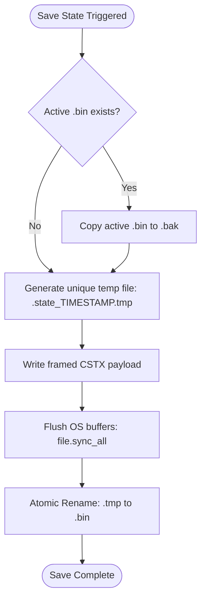

# State Catalog & Storage Architecture Guide

**Project**: `cloud_sync_lib`  
**Applies to**: `cloud_sync_daemon`, `cloud_sync_core`, `cloud_sync_lib`

---

## 1. Overview

A reliable synchronization engine must track the evolution of files across both the local filesystem and remote cloud storage providers over time. `cloud_sync_lib` implements a **3-way synchronization model** powered by a persistent **State Catalog**.

This guide details:
1. The mathematical foundation of 3-way synchronization.
2. The isolated state directory (`sync_state/`) architecture.
3. Pluggable persistence via the `StateStore` trait.
4. The high-performance binary format (`PostcardStateStore` with `CSTX v1` framing and CRC32 checksums).
5. Diagnostic JSON state persistence (`JsonStateStore`).
6. Crash-resilient atomic two-phase write mechanisms (`.bak`).
7. Automated legacy catalog migration on startup.
8. Operational state inspection and reset procedures.

---

## 2. The 3-Way Synchronization Model

### 2.1 The Need for a Baseline State
Simple two-point synchronization (comparing local directly to remote) cannot distinguish whether a file was created on one side or deleted on the other:
- If file `report.pdf` exists locally but not remotely: Was it added locally and needs uploading? Or was it deleted remotely and needs deleting locally?
- If file `notes.txt` exists on both sides with different modification timestamps: Which side represents intentional changes versus concurrent edits?

To resolve these ambiguities deterministically without user intervention, `cloud_sync_lib` maintains a **Base Catalog Snapshot** ($B$), capturing the state at the end of the last successful sync cycle:

```
       +-----------------------+
       |   Base Catalog (B)    |
       | (Last Recorded State) |
       +-----------+-----------+
                   │
       ┌───────────┴───────────┐
       ▼                       ▼
+--------------+       +---------------+
|  Local (L)   |       |  Remote (R)   |
| Current Disk |       | Current Cloud |
+--------------+       +---------------+
```

### 2.2 Decision Matrix
During each reconciliation pass, the sync engine evaluates the 3-tuple `(B, L, R)` for every path:

| Base State ($B$) | Local State ($L$) | Remote State ($R$) | Action Taken | Resulting State |
| :--- | :--- | :--- | :--- | :--- |
| $\varnothing$ (None) | Present | $\varnothing$ (None) | **Upload** to Remote | $L = R = B$ |
| $\varnothing$ (None) | $\varnothing$ (None) | Present | **Download** to Local | $L = R = B$ |
| Present | Modified | Unchanged | **Upload** to Remote | $L = R = B$ |
| Present | Unchanged | Modified | **Download** to Local | $L = R = B$ |
| Present | Deleted | Unchanged | **Delete** from Remote | Cleared from $B$ |
| Present | Unchanged | Deleted | **Delete** from Local | Cleared from $B$ |
| Present | Modified | Modified | **Conflict Policy** applied | Resolved per policy |

---

## 3. The Isolated `sync_state/` Directory

### 3.1 Why State Files Must NOT Live in the Monitored Directory
In legacy synchronization architectures, state catalogs were placed in the root of the monitored folder (e.g., `<watch_dir>/.sync_state_gdrive.bin`). This introduced three severe problems:

1. **Filesystem Watcher Recursion**: Whenever the sync engine updated its catalog after a synchronization cycle, writing the catalog file triggered file modification events in the watcher (`notify` crate). This induced artificial infinite sync loops.
2. **Accidental Cloud Uploads**: Unless complex exclusion filters were perfectly maintained across every backend, hidden state databases risked being synced to remote cloud storage, polluting cloud buckets with internal binary files.
3. **User Confusion & Accidental Deletion**: Hidden files appearing in user documents folders cause friction and accidental deletion by end users.

### 3.2 Dedicated Directory Architecture
`cloud_sync_lib` isolates all catalog files into a dedicated `state_directory` (default: `sync_state/` relative to the workspace root):

```
cloud_sync_lib/
├── config.toml
├── daemon.log
├── sync_state/                        <-- Isolated from watched files!
│   ├── .sync_state_Google_Drive.bin    <-- Active binary catalog (CSTX v1)
│   ├── .sync_state_Google_Drive.bak    <-- Atomic crash backup
│   ├── .sync_state_Dropbox.bin
│   └── .sync_state_Dropbox.bak
└── watched_folder/                     <-- Clean user directory!
    ├── documents/
    ├── photos/
    └── notes.txt
```

---

## 4. Pluggable Storage via `StateStore` Trait

State persistence adheres to the Single Responsibility and Dependency Inversion principles through the `StateStore` trait defined in [`cloud_sync_core`](file:///C:/Projects/cloud_sync_lib/crates/cloud_sync_core/src/state_io.rs):

```rust
#[async_trait::async_trait]
pub trait StateStore: Send + Sync {
    /// Loads the sync state catalog from disk, recovering from backup if corrupt.
    async fn load(&self, path: &Path) -> Result<SyncState, StorageError>;

    /// Persists the sync state catalog atomically with crash resilience.
    async fn save(&self, path: &Path, state: &SyncState) -> Result<(), StorageError>;
}
```

### 4.1 Data Structures

```rust
pub struct SyncItemState {
    pub relative_path: PathBuf,
    pub size: u64,
    pub modified_time: u64,       // Unix timestamp in seconds
    pub checksum: Option<String>, // SHA-256 / MD5
    pub is_directory: bool,
}

pub struct SyncState {
    pub items: HashMap<PathBuf, SyncItemState>,
    pub last_sync_time: u64,
    pub backend_version: u32,
}
```

---

## 5. Storage Implementations & Binary Framing

### 5.1 `PostcardStateStore` (Binary Format `CSTX v1`)
The production store uses Postcard binary serialization preceded by a 13-byte integrity framing header:

```
+---------------+---------------+-----------------------+-----------------------+
|  Magic Bytes  | Version Byte  | Checksum (Big-Endian) |   Postcard Payload    |
|  "CSTX" (4B)  |   0x01 (1B)   |   FNV-1a / CRC (8B)   | (Variable Length N B) |
+---------------+---------------+-----------------------+-----------------------+
```

1. **Magic Signature (`b"CSTX"`)**: Identifies Cloud Sync Transactional State archives immediately.
2. **Version Byte (`0x01`)**: Facilitates forward-compatible format evolution.
3. **Checksum (`u64::to_be_bytes`)**: Computed over the entire Postcard payload. Corrupted records or partial writes fail checksum validation immediately upon read.
4. **Backward Compatibility**: If the `CSTX` framing is absent, `PostcardStateStore` falls back to raw Postcard binary, followed by raw JSON deserialization before failing.

### 5.2 `JsonStateStore` (Diagnostic Inspection)
For debugging and manual inspection, `JsonStateStore` formats the state catalog as human-readable, indented JSON while retaining atomic write protection and `.bak` backup mechanics.

### 5.3 Crash-Resilient Two-Phase Writes (`.bak`)
To guarantee that sudden power loss, process termination, or kernel panics never corrupt catalog databases:



- **Atomic Rename**: Replaces the active file in a single OS filesystem operation (`rename` syscall on POSIX, `MoveFileExW` with `MOVEFILE_REPLACE_EXISTING` on Windows).
- **Automated Fallback**: If loading `.bin` fails checksum validation or encounters EOF truncation, the store automatically attempts recovery from `.bak`.

---

## 6. Startup Legacy Migration Engine

When upgrading from older versions where `.sync_state` was located inside the watched folder, `cloud_sync_daemon` automatically migrates legacy databases without manual intervention:

1. Scans the root of `watch_dir` for entries starting with `.sync_state`.
2. Discovered files (e.g. `watched_folder/.sync_state_Google_Drive.bin`) are moved into `state_dir/.sync_state_Google_Drive.bin`.
3. An audit log is emitted to `daemon.log`.
4. Subsequent cycles execute strictly against `sync_state/`.

---

## 7. Configuration & Operational Management

### 7.1 TOML Configuration
Configure catalog paths in `config.toml` or `private_config.toml`:

```toml
[sync]
watch_directory = "watched_folder"
interval_seconds = 30

# Path to the isolated state directory
state_directory = "sync_state"
```

### 7.2 CLI Launch Override
```bash
cargo run --bin cloud_sync_daemon -- --state-dir custom_state_dir
```

### 7.3 Verifying State Directory via TCP Socket
```bash
echo "status" | nc 127.0.0.1 8081
```

### 7.4 Forcing a Full Resynchronization
If state becomes desynchronized due to offline edits on multiple unsynced machines:
1. Stop the daemon (`echo "stop" | nc 127.0.0.1 8081`).
2. Remove the state database for the affected provider:
   ```powershell
   Remove-Item sync_state\.sync_state_Google_Drive.*
   ```
3. Restart the daemon. On startup, the engine will perform a full scan of both local and remote storage, reconciling changes based on the active `conflict_policy`.
