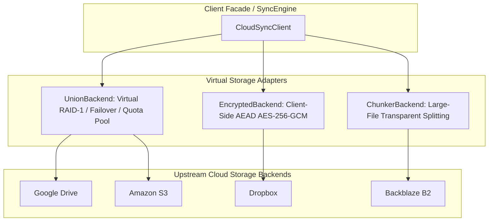

# Virtual Storage Backends & Layered Middleware Architecture

This document provides a comprehensive technical guide to the composite virtual storage backends (`UnionBackend`, `ChunkerBackend`, `EncryptedBackend`) and the OpenDAL-style composable middleware layers (`CompressionLayer`, `CacheLayer`, `RetryLayer`, `CircuitBreakerLayer`, `RateLimitLayer`, `MetricsLayer`, `LoggingLayer`) implemented in `cloud_sync_lib`.

---

## 1. Composable Onion Middleware Pipeline

The layered middleware architecture is governed by the `StorageLayer` trait and `LayeredBackendExt` extension trait:

```rust
pub trait StorageLayer: Send + Sync {
    fn layer(&self, backend: Arc<dyn StorageBackend>) -> Arc<dyn StorageBackend>;
}
```

Any backend implementing `StorageBackend` can be decorated with multiple layers in onion order:

```rust,no_run
use cloud_sync_lib::layers::{
    CacheLayer, CircuitBreakerConfig, CircuitBreakerLayer, CompressionLayer,
    LayeredBackendExt, LoggingLayer, MetricsLayer, RateLimitLayer, RetryConfig, RetryLayer,
};
use cloud_sync_core::StorageBackend;
use std::sync::Arc;
use std::time::Duration;

pub fn apply_standard_pipeline(raw_backend: Arc<dyn StorageBackend>) -> Arc<dyn StorageBackend> {
    raw_backend
        .with_layer(CircuitBreakerLayer::new(CircuitBreakerConfig::default()))
        .with_layer(RetryLayer::new(RetryConfig::default()))
        .with_layer(RateLimitLayer::new(10 * 1024 * 1024, 20 * 1024 * 1024)) // 10MB/s up, 20MB/s down
        .with_layer(CompressionLayer::new()) // Pure-Rust CLZ1 lossless compression
        .with_layer(CacheLayer::new(Duration::from_secs(30))) // TTL metadata listing cache
        .with_layer(MetricsLayer::new())
        .with_layer(LoggingLayer::new())
}
```

---

## 2. Virtual Storage Backends

Virtual backends wrap one or more underlying `StorageBackend` instances, presenting a unified `StorageBackend` interface to the consumer while executing advanced routing, splitting, or transformation behind the scenes.



### 2.1 Multi-Cloud Union (`UnionBackend`)

The `UnionBackend` ([`providers/union.rs`](file:///C:/Projects/cloud_sync_lib/crates/cloud_sync_lib/src/providers/union.rs)) unifies multiple storage providers into a single virtual namespace with configurable write and read policies:

#### Policies (`UnionPolicy`)
- **`MirrorAll` (Virtual RAID-1)**: Replicates uploads across all configured upstreams simultaneously. Reads and listings query the first responsive healthy backend with seamless automatic failover.
- **`FirstAvailable` (Active-Passive Failover)**: Directs writes to the primary provider; automatically fails over to secondary or tertiary providers if the primary returns transient or network errors.
- **`RoundRobin` (Storage Quota Pooling)**: Distributes successive file uploads evenly across member providers, effectively combining storage quotas across multiple free-tier cloud accounts.
- **Extensible Custom Routing**: Supports the Open-Closed Principle via the `UnionRoutingStrategy` trait, allowing consumers to inject custom routing algorithms (e.g. latency-based, cost-based, or geofenced routing).

```rust,no_run
use cloud_sync_lib::providers::union::{UnionBackend, UnionPolicy};
use cloud_sync_core::StorageBackend;
use std::sync::Arc;

fn create_mirrored_backend(
    primary: Arc<dyn StorageBackend>,
    secondary: Arc<dyn StorageBackend>,
) -> Arc<dyn StorageBackend> {
    Arc::new(UnionBackend::new(
        "MirroredCloud",
        vec![primary, secondary],
        UnionPolicy::MirrorAll,
    ))
}
```

### 2.2 Large-File Chunker (`ChunkerBackend`)

Many cloud storage providers enforce strict single-file size limits or experience connection resets on multi-gigabyte uploads. The `ChunkerBackend` ([`providers/chunker.rs`](file:///C:/Projects/cloud_sync_lib/crates/cloud_sync_lib/src/providers/chunker.rs)) transparently partitions large files:

- **Chunk Splitting**: Files strictly larger than `chunk_size_bytes` (e.g. 100 MB) are divided into numbered parts: `<filename>.cschunk_00001`, `<filename>.cschunk_00002`, etc.
- **JSON Manifest**: Stores a companion `<filename>.cschunk_manifest` holding original file size, chunk count, and SHA-256 hashes for each individual part.
- **Constant Memory Footprint**: Reads and streams chunks in fixed 64 KiB buffers using `TempFileGuard`, avoiding multi-gigabyte heap allocations.
- **Transparent Virtualization**:
  - `list()` hides the internal `.cschunk_*` part files and manifest, synthesizing a single logical `StorageItem` matching the original file name and size.
  - `download()` transparently streams, verifies the SHA-256 hash of each part, and reconstructs the unfragmented file.

```rust,no_run
use cloud_sync_lib::providers::chunker::ChunkerBackend;
use cloud_sync_core::StorageBackend;
use std::sync::Arc;

fn create_chunked_backend(raw: Arc<dyn StorageBackend>) -> Arc<dyn StorageBackend> {
    // Split files larger than 50 MB into 50 MB chunks
    Arc::new(ChunkerBackend::new(raw, 50 * 1024 * 1024))
}
```

### 2.3 Client-Side Zero-Knowledge Encryption (`EncryptedBackend`)

Defined in [`providers/encryption.rs`](file:///C:/Projects/cloud_sync_lib/crates/cloud_sync_lib/src/providers/encryption.rs):
- **AEAD AES-256-GCM**: Authenticated encryption ensuring both secrecy and cryptographic tamper detection.
- **Key Derivation**: PBKDF2-HMAC-SHA256 with 100,000 iterations and per-file cryptographic random salt.
- **Memory Zeroization**: Cryptographic keys implement `zeroize::Zeroize` to scrub sensitive material from memory immediately after cipher execution.

---

## 3. Composable Middleware Layers Catalog

### 3.1 Transparent Lossless Compression (`CompressionLayer`)
Located in [`layers/compression.rs`](file:///C:/Projects/cloud_sync_lib/crates/cloud_sync_lib/src/layers/compression.rs):
- **Pure-Rust `CLZ1` Format**: Combines sliding-window LZ77 match parsing with Run-Length Encoding (RLE). Requires zero C dependencies, ensuring full cross-platform compatibility on Windows, Linux, macOS, and Android.
- **Self-Identifying Header**: Encodes a 4-byte magic identifier (`CLZ1`) and mode flag:
  - `MODE_RAW (0x00)`: If a file is incompressible (e.g., JPEGs, ZIPs, encrypted blobs), it is stored uncompressed to prevent negative compression size inflation.
  - `MODE_LZ (0x01)`: Compressed payload.
- **Transparent Remote Fallback**: Pre-existing uncompressed files stored in the cloud are downloaded raw without failure if the `CLZ1` magic header is absent.

### 3.2 Metadata & Directory Listing Cache (`CacheLayer`)
Located in [`layers/cache.rs`](file:///C:/Projects/cloud_sync_lib/crates/cloud_sync_lib/src/layers/cache.rs):
- **Configurable TTL**: Caches `list()` responses in memory for a specified duration (e.g., 30 seconds), eliminating redundant API calls and rate-limit penalties during frequent sync evaluation cycles.
- **Write-Through Invalidation**: Any mutating operation (`upload`, `delete`, `create_folder`, `rename`, `copy`) automatically purges cached directory entries for affected parent paths.

### 3.3 Full-Jitter Exponential Retry (`RetryLayer`)
Located in [`layers/retry.rs`](file:///C:/Projects/cloud_sync_lib/crates/cloud_sync_lib/src/layers/retry.rs):
- Automatically catches transient errors (`StorageError::is_transient()`, HTTP 429, 500, 502, 503, 504, connection timeouts).
- Uses AWS-standard Full Jitter backoff math to eliminate retry storms:
  
  $$\text{SleepDuration} = \text{random}\left(0, \min(M, B \cdot 2^{\text{attempt} - 1})\right)$$

### 3.4 Outage Isolation (`CircuitBreakerLayer`)
Located in [`layers/circuit_breaker.rs`](file:///C:/Projects/cloud_sync_lib/crates/cloud_sync_lib/src/layers/circuit_breaker.rs):
- Fails fast during sustained cloud outages to protect thread pools.
- Implements the three-state machine: `Closed`, `Open`, `HalfOpen`.

### 3.5 Bandwidth Throttling (`RateLimitLayer`)
Located in [`layers/rate_limit.rs`](file:///C:/Projects/cloud_sync_lib/crates/cloud_sync_lib/src/layers/rate_limit.rs):
- Regulates network throughput using independent upload and download Token Buckets.
- Allows short controlled bursts while strictly enforcing sustained byte rate limits.

---

## 4. Layer Ordering Best Practices

To ensure maximum performance and error resilience, layers should be composed from the innermost (closest to the raw network backend) to outermost (closest to the caller):

```
[Caller / Application]
      │
      ▼
1. LoggingLayer         (Measures total client duration including retries)
      │
      ▼
2. MetricsLayer         (Tracks high-level call counters & latency distributions)
      │
      ▼
3. CacheLayer           (Short-circuits list() calls before touching compression/rate limiter)
      │
      ▼
4. CompressionLayer     (Compresses payloads before rate limiting measures bandwidth)
      │
      ▼
5. RateLimitLayer       (Meters actual wire bytes being transmitted)
      │
      ▼
6. RetryLayer           (Retries transient failures)
      │
      ▼
7. CircuitBreakerLayer  (Trips immediately when downstream provider stays dead)
      │
      ▼
[StorageBackend (Provider / Virtual Chunker / Union)]
```
