# Documentation Improvement Plan: Architecture, Interfaces & Configuration

**Project**: `cloud_sync_lib`  
**Date**: October 2026  
**Status**: Completed  

---

## Executive Summary

A comprehensive source code and documentation analysis was conducted across the `cloud_sync_lib` workspace. The codebase has recently received significant architectural improvements:
1. **Configurable Log Destinations**: Tracing appender configurable via `config.toml`, CLI `--log-file`, exposed via TCP (`get_log`), HTTP (`GET /api/logs`), and integrated into both desktop interfaces.
2. **State Directory Isolation (`sync_state/`)**: Relocation of `.sync_state_*.bin` and `.bak` catalog databases out of the monitored watch directory into a dedicated folder (`sync_state`), with automatic startup migration.
3. **Dual Frontend Interfaces**: Decoupled Axum Web UI (`cloud_sync_ui`) with SSE streaming and interactive conflict resolution, alongside a native immediate-mode desktop app (`cloud_sync_egui`) with embedded log viewers and OS editor launching.
4. **Convenience Launchers**: Zero-console helper scripts (`scripts/launch_egui.cmd` and `scripts/launch_web_ui.cmd`) on Windows.

However, existing documentation does not fully reflect these capabilities, several crate README links in the root `README.md` are broken, and multiple crates lack dedicated documentation. This plan establishes the exact documents to create and modify.

---

## 1. Documentation Gap Analysis

| Scope | Item | Current State | Defect / Gap | Target Action |
| :--- | :--- | :--- | :--- | :--- |
| **Root** | `README.md` | Links to non-existent README files in `cloud_sync_ui` and `cloud_sync_tauri`; links to directories for `egui`, `core`, `std`. | Broken markdown links; missing UI launch scripts and state isolation details. | **Modify** |
| **Crate** | `crates/cloud_sync_ui/README.md` | Non-existent | Broken link from root; no documentation for Axum endpoints, SSE stream, or `/api/logs`. | **Create** |
| **Crate** | `crates/cloud_sync_egui/README.md` | Non-existent | No crate documentation for native eframe client, architecture, or windowless spawning. | **Create** |
| **Crate** | `crates/cloud_sync_core/README.md` | Non-existent | No documentation for `no_std` core traits, errors, and abstractions. | **Create** |
| **Crate** | `crates/cloud_sync_std/README.md` | Non-existent | No documentation for checksum algorithms, ignore matchers, and std utils. | **Create** |
| **Crate** | `crates/cloud_sync_tauri/README.md` | Non-existent | Broken link from root; no documentation on sidecar orchestration or cross-platform packaging. | **Create** |
| **Crate** | `crates/cloud_sync_daemon/README.md` | Partial CLI docs from v0.1 | Missing `--log-file`, `--state-dir`, single-shot mode, TCP protocol, and rate limiting. | **Modify** |
| **Docs** | `docs/USER_GUIDE.md` | General guide | Missing convenience scripts (`launch_web_ui.cmd`, `launch_egui.cmd`), log viewer usage, and state dir options. | **Modify** |
| **Docs** | `docs/architecture.md` | High-level diagram | Lacks state directory isolation subsystem, logging pipeline architecture, and `cloud_sync_egui` flow. | **Modify** |
| **Docs** | `docs/logging_and_diagnostics.md` | Non-existent | No unified reference for tracing layers, file sinks, TCP `get_log`, HTTP `/api/logs`, or Windows file-sharing gotchas. | **Create** |
| **Docs** | `docs/state_and_storage.md` | Non-existent | No technical specification of state catalog binary serialization, `.bak` recovery, or migration out of watch folder. | **Create** |
| **Docs** | `docs/troubleshooting.md` | Non-existent | Users must guess how to fix expired OAuth tokens, simulation fallbacks, Windows sharing locks, or port collisions. | **Create** |

---

## 2. Plan for New Documents to Add

### 2.1. Crate Documentation: `crates/cloud_sync_ui/README.md`
- **Purpose**: Provide full documentation for the decoupled Axum web dashboard server.
- **Contents**:
  - Architecture overview (Axum + Tower CORS + Server-Sent Events).
  - API endpoint catalog:
    - `GET /`: Serves embedded single-page dashboard (`index.html`).
    - `GET /api/status`: Real-time status parsed from daemon TCP socket.
    - `GET /api/logs`: Plaintext stream of the active daemon log file.
    - `GET /api/events`: SSE stream broadcasting live file sync events.
    - `POST /api/start`, `POST /api/stop`, `POST /api/pause`, `POST /api/resume`, `POST /api/sync`, `POST /api/reload`.
    - `GET /api/conflicts`, `POST /api/conflicts/resolve`: Interactive 3-way conflict resolution.
  - Integration instructions with Tauri and stand-alone browser usage.
  - Configuration environment variables (`CLOUDSYNC_UI_ADDR`, `CLOUDSYNC_DAEMON_ADDR`).

### 2.2. Crate Documentation: `crates/cloud_sync_egui/README.md`
- **Purpose**: Document the native immediate-mode desktop application built on `egui` and `eframe`.
- **Contents**:
  - Application design: Dark theme styling, non-blocking Tokio runtime bridge, and decoupled TCP socket communication.
  - Feature walkthrough: System Status card, Operations Center, Storage Providers pill list, and embedded Log Viewer modal.
  - Windows windowless launching and external editor delegation (`powershell Start-Process` with Notepad fallback).
  - How to run: `scripts\launch_egui.cmd` or `cargo run --bin cloud_sync_egui`.

### 2.3. Crate Documentation: `crates/cloud_sync_core/README.md`
- **Purpose**: Document the foundational zero-dependency, `no_std`-compatible layer.
- **Contents**:
  - `StorageBackend` trait contract (`upload`, `download`, `delete`, `list`, `create_folder`).
  - Core data models: `StorageItem`, `StorageError`, `SyncPolicy`, `SyncMode`, `ConflictPolicy`.
  - Design rationale: Isolating abstract storage interfaces from network and I/O implementations.

### 2.4. Crate Documentation: `crates/cloud_sync_std/README.md`
- **Purpose**: Document standard library utilities used across the workspace.
- **Contents**:
  - Checksum computation utilities (SHA-256, MD5, CRC32).
  - Gitignore pattern matcher (`SyncIgnore`) and exclusion engine.
  - Path normalization, directory boundary validation, and traversal sanitizer.

### 2.5. Crate Documentation: `crates/cloud_sync_tauri/README.md`
- **Purpose**: Document the cross-platform desktop shell wrapping the Web UI.
- **Contents**:
  - Tauri configuration (`tauri.conf.json`) and architecture.
  - Daemon sidecar bundling for Windows, macOS, and Linux.
  - Auto-launch hooks on system boot.

### 2.6. Technical Guide: `docs/logging_and_diagnostics.md`
- **Purpose**: Complete guide to logging, observability, and diagnostics across the ecosystem.
- **Contents**:
  - Tracing configuration: Non-rolling file appender (`tracing_appender::rolling::never`), stdout layer, and filter env vars.
  - Configuration parameters: `log_file = "daemon.log"` in TOML, `--log-file <path>` CLI flag.
  - Log access layers:
    - Direct disk inspection.
    - Daemon TCP command: `echo "get_log" | nc 127.0.0.1 8081`.
    - HTTP endpoint: `GET /api/logs` (viewable in browser tabs).
    - Desktop UI modal and external text editor invocation.
  - Technical resolution of Windows `ERROR_SHARING_VIOLATION` when files are accessed while open for appending.

### 2.7. Technical Guide: `docs/state_and_storage.md`
- **Purpose**: Deep dive into synchronization state catalog storage and directory isolation.
- **Contents**:
  - Purpose of the sync catalog: Tracking local/remote modification timestamps, file sizes, and checksum hashes for 3-way synchronization.
  - The `sync_state/` directory: Why state files must never reside inside the watched folder (eliminates watcher recursion, directory clutter, and inadvertent cloud uploads).
  - File layout: `.sync_state_<backend>.bin` (active database) and `.sync_state_<backend>.bak` (atomic write backup).
  - Configuration: `state_directory = "sync_state"` in TOML, `--state-dir <path>` CLI flag.
  - Automatic legacy migration mechanism on startup.

### 2.8. User & Admin Guide: `docs/troubleshooting.md`
- **Purpose**: Practical reference addressing real-world operational challenges.
- **Contents**:
  - **OAuth 2.0 Credentials & Token Expiration**: Steps for regenerating expired refresh tokens using `scripts/get_*.py` for Google Drive, Dropbox, OneDrive, and Box.
  - **Simulation Mode Active Warning**: Diagnosing why a backend shows `[Simulated]` instead of syncing to the cloud (missing credentials or placeholder values).
  - **Console Window Artifacts on Windows**: Explanation of Windows subsystem flags (`#![windows_subsystem = "windows"]`) and `CREATE_NO_WINDOW (0x08000000)` process flags.
  - **Port Conflicts**: Resolving TCP socket bind errors on `127.0.0.1:8081` (daemon) or `127.0.0.1:8082` (Web UI).
  - **Database & State Recovery**: Restoring corrupted state catalogs using `.bak` backups or triggering a fresh full scan.

---

## 3. Plan for Existing Documents to Modify

### 3.1. `README.md`
- **Modifications**:
  1. Fix broken markdown links in the **Workspace Structure** section (`crates/cloud_sync_ui/README.md`, `crates/cloud_sync_tauri/README.md`, etc.).
  2. Add **Quick Launch** section showcasing `scripts\launch_web_ui.cmd` and `scripts\launch_egui.cmd`.
  3. Update **Key Features** to mention configurable logging, isolated state directory, and dual GUI frontends.
  4. Update **Configuration** section to demonstrate `log_file` and `state_directory` parameters.
  5. Add links to newly created documentation guides (`docs/logging_and_diagnostics.md`, `docs/state_and_storage.md`, `docs/troubleshooting.md`).

### 3.2. `docs/USER_GUIDE.md`
- **Modifications**:
  1. Add quick launch batch script instructions (`scripts\launch_web_ui.cmd` and `scripts\launch_egui.cmd`).
  2. Expand **Daemon Command Line Interface** section:
     - Document `--log-file <PATH>`.
     - Document `--state-dir <PATH>`.
     - Document `--single-shot`, `--conflict-policy`, `--dry-run`, `--exclude`.
  3. Expand **TCP Control Protocol** section to document `get_log` and `State Directory` in status response.
  4. Expand **Web Dashboard** section to describe the new log viewing features and link to `/api/logs`.
  5. Expand **Egui Desktop Application** section to detail the embedded log viewer modal and editor integration.
  6. Add cross-references to the new troubleshooting and logging guides.

### 3.3. `docs/architecture.md`
- **Modifications**:
  1. Update Mermaid diagram to include:
     - The `sync_state/` directory and catalog persistence.
     - The configurable log file sink and log distribution pipeline.
     - The `cloud_sync_egui` client connected directly to the daemon TCP control socket.
  2. Add section **5. State Management & Catalog Isolation**: Detail the separation of user data (`watched_folder`) from synchronization metadata (`sync_state`).
  3. Add section **6. Observability & Logging Architecture**: Detail the tracing subscriber, non-blocking file appender, and multi-interface log delivery.

### 3.4. `crates/cloud_sync_daemon/README.md`
- **Modifications**:
  1. Add modern configuration options (`log_file = "daemon.log"` and `state_directory = "sync_state"`).
  2. Document all CLI flags: `--log-file`, `--state-dir`, `--single-shot`, `--conflict-policy`, `--dry-run`, `--exclude`, `--pmu-hook`.
  3. Document the TCP socket control command set.

---

## 4. Execution Sequence & Milestones

```mermaid
gantt
    title Documentation Implementation Phases
    dateFormat  X
    axisFormat %s

    section Phase 1: Core Guides
    docs/logging_and_diagnostics.md        :p1_1, 0, 1
    docs/state_and_storage.md               :p1_2, 0, 1
    docs/troubleshooting.md                 :p1_3, 0, 1

    section Phase 2: Crate READMEs
    crates/cloud_sync_ui/README.md          :p2_1, 1, 2
    crates/cloud_sync_egui/README.md        :p2_2, 1, 2
    crates/cloud_sync_core/README.md        :p2_3, 1, 2
    crates/cloud_sync_std/README.md         :p2_4, 1, 2
    crates/cloud_sync_tauri/README.md       :p2_5, 1, 2

    section Phase 3: Updates & Review
    Update crates/cloud_sync_daemon/README.md :p3_1, 2, 3
    Update docs/USER_GUIDE.md               :p3_2, 2, 3
    Update docs/architecture.md             :p3_3, 2, 3
    Update root README.md                   :p3_4, 2, 3
```

### Phase 1: Foundational Technical Guides
1. Create `docs/logging_and_diagnostics.md`.
2. Create `docs/state_and_storage.md`.
3. Create `docs/troubleshooting.md`.

### Phase 2: Crate Documentation & Link Repairs
1. Create `crates/cloud_sync_ui/README.md`.
2. Create `crates/cloud_sync_egui/README.md`.
3. Create `crates/cloud_sync_core/README.md`.
4. Create `crates/cloud_sync_std/README.md`.
5. Create `crates/cloud_sync_tauri/README.md`.

### Phase 3: Update Existing Root and Architecture Documentation
1. Update `crates/cloud_sync_daemon/README.md`.
2. Update `docs/USER_GUIDE.md`.
3. Update `docs/architecture.md`.
4. Update `README.md` to link all new documents and repair broken references.

---

## 5. Verification Checklist

- [x] All markdown links across `README.md`, `docs/`, and crate READMEs resolve to valid existing files.
- [x] No mention of `.sync_state` residing in `watch_directory` remains uncorrected.
- [x] Both frontends (`cloud_sync_ui` and `cloud_sync_egui`) have complete, accurate usage instructions and launch script references.
- [x] Every CLI flag supported by `cloud_sync_daemon` is documented with examples.
- [x] Tracing log configuration and `/api/logs` endpoint are fully specified.
